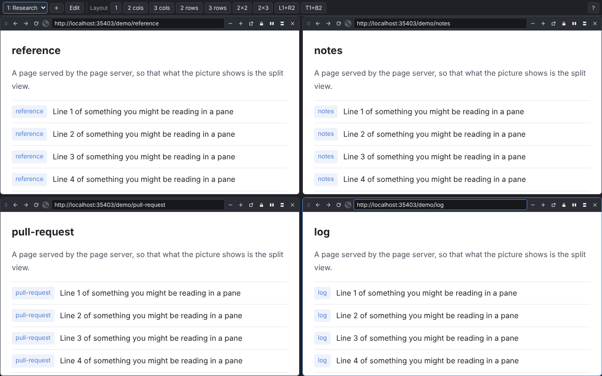

<!-- cspell:ignore nifmgpafbfpgpcijgmfpcoonjbalbkhf -->

# Split View (v2)

A rebuild of [`apps/split-view-extension`](../split-view-extension/README.md),
written from its specification rather than from its code. It replaces that
directory once it does everything [`docs/spec.md`](./docs/spec.md) lists; until
then the two live side by side, and nothing outside this directory depends on
this one.



What it does for a user is what the current extension's README says: one tab
split into a grid of live pages, each with its own address bar and history,
saved as you go. It is the same extension to Chrome — the manifest carries the
same `key`, so the id is `nifmgpafbfpgpcijgmfpcoonjbalbkhf` and it reads the
split views the current build saved. **Load one build or the other, never
both.**

## How it is built

The specification is [`docs/spec.md`](./docs/spec.md); each requirement has an
id the code and the tests name.

| directory         | what is in it                                                                                                                                                                                                                     |
| :---------------- | :-------------------------------------------------------------------------------------------------------------------------------------------------------------------------------------------------------------------------------- |
| `src/core/`       | everything that is a decision rather than a call to Chrome: the layout tree and its geometry, a split view and its reducer, the URL, the storage codecs, the pane-load state machine, the messages. Pure, and unit-tested in Node |
| `src/platform/`   | the Chrome calls, each written once: the framing rules, storage, the list writes, the open-view records, tabs                                                                                                                     |
| `src/background/` | the service worker: the toolbar button, the context menus, the framing rule, the GitHub button's requests, and every write to the list                                                                                            |
| `src/content/`    | the content scripts: `frame-agent` in every pane, `github-button` on GitHub's pull requests                                                                                                                                       |
| `src/page/`       | `split.html`: a controller that owns the state and the saving, and components that only draw it                                                                                                                                   |
| `test/`, `e2e/`   | the unit tests, and the Playwright suite that loads the build into Chromium                                                                                                                                                       |
| `scripts/`        | the page server the e2e suite and the screenshots use, the icons, and packing                                                                                                                                                     |

## Development

From this directory, once the workspace is installed and its libraries built
(`pnpm --filter-prod 'split-view-extension-v2...' run build` from the root
builds the extension with what it depends on):

```sh
pnpm run build               # writes dist/, which is what chrome://extensions loads
pnpm run build:dev           # the same, plus the diagnostics and the localhost links
pnpm run test                # the unit tests
pnpm run check:e2e           # builds, then runs the UI in Chromium headless
pnpm run gen:icons           # redraws public/icons/*.png
pnpm run screenshots         # writes pack/screenshots/ and docs/screenshots/
pnpm run screenshots:light   # the light theme, into pack/screenshots-light/ only
pnpm run pack                # the Chrome Web Store zip, in pack/
```

There is no dev server: the page has to be served from `chrome-extension://`,
because that origin is what the framing rule is keyed to. After a change,
`pnpm run build` and press reload on the extension's card.

The e2e suite and the screenshots load the build into Chromium itself
(`channel: 'chromium'`), whose new headless mode loads extensions, so neither
needs a display. The pages the panes show come from
[`scripts/page-server.mts`](./scripts/page-server.mts), which listens on port 0
and is asked which port it got (spec D3): nothing fixed can collide with a dev
server, and nothing needs the network. In CI the build job's `dist/` is used
rather than a new build.
