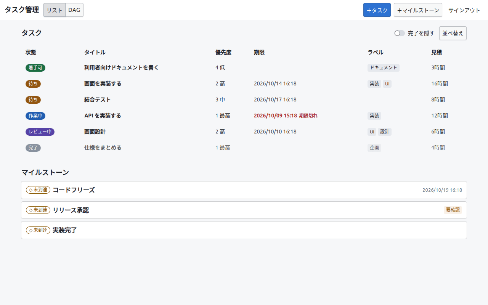
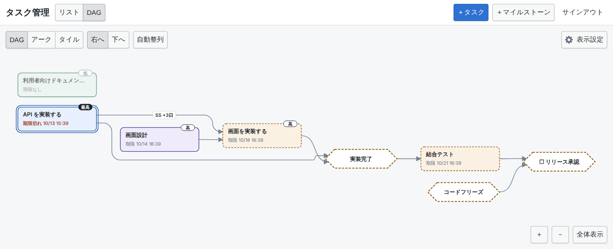
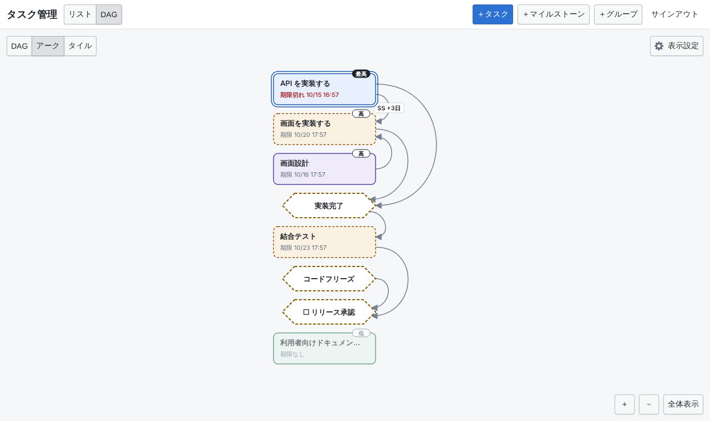
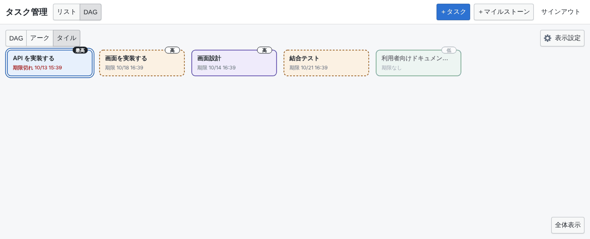
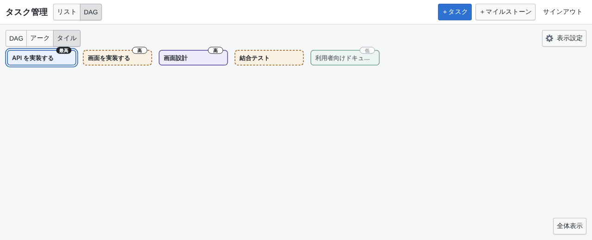
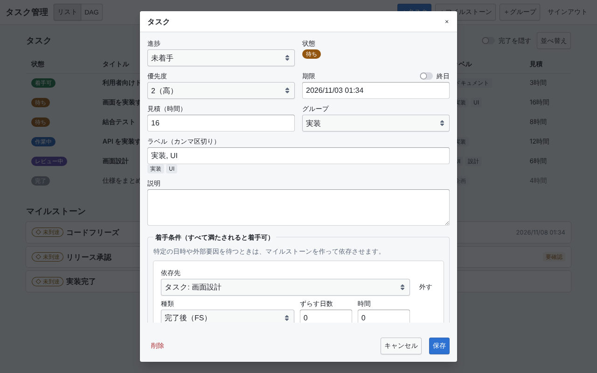
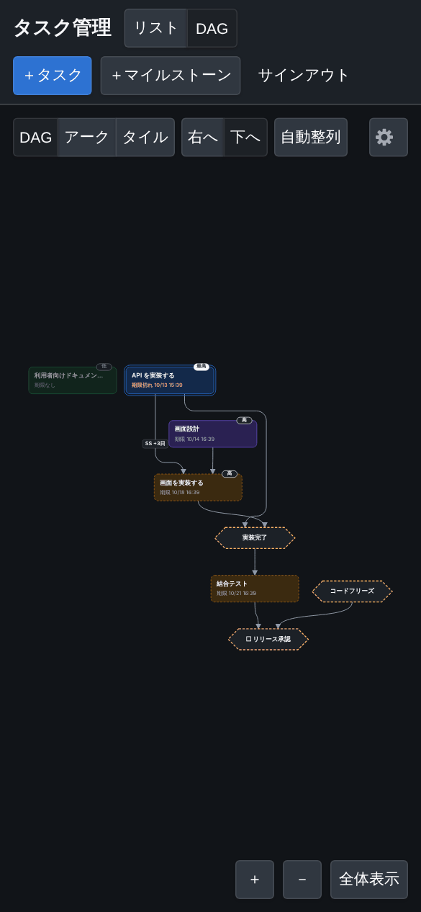
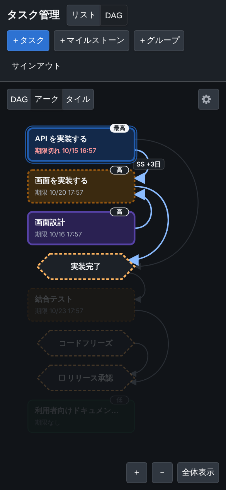
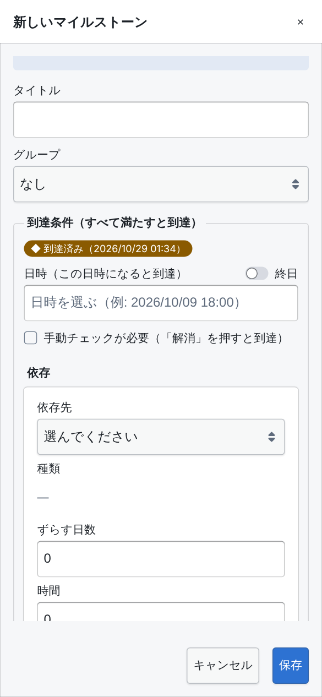
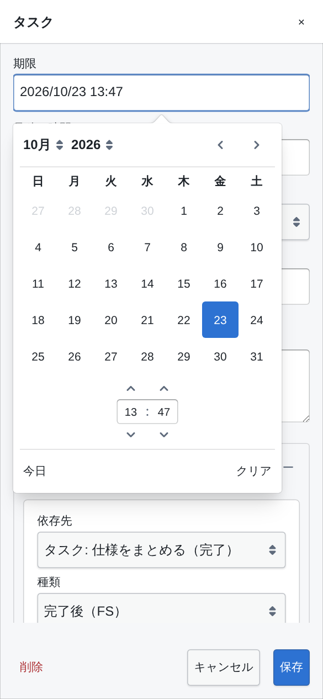

# `task-manager`

**タスク管理** — タスクとマイルストーンの依存関係（DAG）を中心にした個人用のタスク管理アプリ。

<https://noshiro-pf.github.io/mono/task-manager/>

## 概要

- タスクの進捗（未着手・作業中・レビュー中・完了）は手で設定し、未着手のタスクが
  「着手可」か「待ち」かは依存関係から導出する（`src/domain/`）。
- 依存は「完了後（FS）」「開始後（SS）」と、ずらす時間（ラグ）を持つ。マイルストーンは
  日時・手動確認・依存の組み合わせで到達する。循環する依存は追加できない。
- 期限とマイルストーンの日時は「終日」にでき、そのときは日付だけを選び、時刻を
  表示しない。終日の期限はその日の終わり（23:59:59.999）、終日のマイルストーンは
  その日の始まりに到達するものとして、期限切れの判定や並べ替えに使う。日付は設定した
  端末のタイムゾーンで時刻に直して保存し（`dueAllDay` / `dateAllDay` を添える）、表示は
  見ている端末のタイムゾーンで日付に戻す。この欄のない以前の文書は終日でないものとして
  読む。
- 表示はリスト（幅の広い画面では表、スマートフォンではカード）と DAG（SVG で描画）の
  2 種類で、開いたときは DAG。ノードをタップすると詳細ダイアログが開く。DAG の画面は
  ツールバー先頭の切り替えで「DAG」「アーク」「タイル」の 3 つの表示形式を選べ、選択は
  端末ごとに `localStorage` に保存される（既定は「DAG」）。表示中の画面と表示形式は URL の
  クエリにも書かれ（DAG のときは `?mode=arc` のように表示形式だけ、リストのときは
  `?view=list`）、再読み込みやリンクではそれを開く。以前のリンクの `?view=dag` も
  読める。知らない値は無いものとして扱い、画面は DAG、表示形式は端末に保存された
  ものになる（`src/view-model/view-query.mts`）。
- 表示は日本語と英語（`src/i18n/`）。URL の `?lang=en` / `?lang=ja` がいちばん強く、
  次に表示設定（とサインイン画面）の「言語」で選んで端末の `localStorage` に保存した
  もの、どちらもなければ（「ブラウザに合わせる」を選んだときも）ブラウザの言語の順で
  決まる（ブラウザの言語に日本語も英語もなければ英語）。言語はページを開いたときに
  決まり、切り替えるとページを読み込み直す（読み込みの書き込み中は切り替えられない）。
  文言は言語ごとの辞書にまとめ、英語の辞書が日本語と同じキーを持つことは型で保証する。
  日時ピッカーのカレンダーは言語に合わせ、日時の書式はどちらの言語でも入力欄と同じ
  `2026/10/09 18:00`。
- タスクのラベルは 1 つずつ入力する（`src/components/label-input.tsx`）。カンマ
  （`,` `、` `，`）か Enter で確定するとチップになり、チップの × か、空の欄での
  Backspace で外せる。保存すると入力途中の分も追加する。大文字小文字や全角半角
  だけが違うラベルは重ねて付けず（一括編集では、タスクに付いているラベルとも）、
  使われているラベルとそれだけが違う入力は使われている綴りで付ける。入力中は、
  タスクに付いているラベルのうち入力で始まるもの、次に入力を含むものを、使われている
  数の多い順に 8 件まで欄の下に出し（大文字小文字と全角半角は区別しない）、上下キーと
  Enter かタップで選べる。Esc は候補だけを閉じる。日本語入力の変換中の読点では確定
  しない。一括編集の「追加するラベル」も同じ。
- DAG のノードはドラッグ（または選択して矢印キー）で動かせ、位置はプロジェクトごとに
  保存されてどの端末でも同じになる。「自動整列」は ELK でレイアウトし直し、伸ばす向き
  （右へ・下へ）を選べる。「自動整列」のあとノードを動かしていなければ、ノードや依存を
  追加・削除するたびに自動でレイアウトし直す（向きやノードの大きさを変えたときは除く）。
  ノードを動かしたあとに追加したノードは、ELK の配置で隣にあるノードとの位置関係を保ち、
  ほかのノードと重ならない最寄りの位置に置いて保存する。
  依存の矢印は向きに沿ってノードの辺に垂直に出入りするベジェ曲線。曲線がほかの
  ノードを横切るときは、ノードを避けて角を丸めた経路に引き直す
  （`src/dag/edge-routing.mts`）。
- DAG を最初に開いたとき、「自動整列」（自動で整列し直したときを含む）のあと、
  別の端末で保存された配置が届いたときは、ノードが短いアニメーションで位置へ移る。
  動いている間に画面を押すとすぐ止まる。
  「表示設定」の「アニメーション」で、「自動」（端末の「視差効果を減らす」に従う。
  既定）・「オン」（常に動かす）・「オフ」（動かさない）を選べ、選択は端末ごとに
  `localStorage` に保存される。どの設定でも、フレームの間隔が長すぎる（3 フレーム目
  以降の平均が 34 ms を超える、または 1 回でも 100 ms を超える）ときは重いとみなして
  途中で止め、すぐ位置に置く（`src/dag/frame-budget.mts`）。
- 「アーク」はアークダイアグラム。タスクとマイルストーンを 1 列に並べ、依存を
  DAG と同じく 1 本ずつ列の右側の弧で描く（`src/dag/arc-*.mts`）。タスクは
  「並び順」（下記。既定はタイトル順）に並び、マイルストーンはそれを待つ最初の
  ノードのすぐ上に入る。待つノードが無いものは、待っている最後のノードのすぐ下に、
  どちらも無いものは列の最後に入る（`arcDiagramIds`）。同じ位置に入る
  マイルストーン同士は、待たれる側を上にする。ノードの右辺は揃え、種類とラグ
  （「SS」「+3日」）を弧の頂点に書く。弧はノードの右辺（マイルストーンでは
  六角形の斜辺）から水平に出て水平に入る 3 次ベジェ曲線で、制御点を縦の距離の 2/3
  だけ右に置き、縦の距離のおよそ半分だけ右に膨らむ半円に近い形になる。1 つの
  ノードに付く弧は右辺に散らして、同じ側の長い弧が短い弧を外から囲むように並べる。
  ノードにポインタを重ねるかフォーカスすると、その弧と相手のノードを強調し、
  ほかを薄くする。位置はデータから決まるため、ドラッグや矢印キーでは動かず、
  「自動整列」と向きの切り替えも出さない（背景のドラッグとズームはできる）。
  開いたときは列全体をツールバーと下のボタンのあいだに収める。下のボタンは
  「等倍表示」と「全体表示」を切り替え、「等倍表示」は 1 倍で上端から表示する
  （長い列はパンして読む）。表示形式を切り替えると、
  ノードは今の位置から新しい位置へ動き、一方の表示形式にしか無いノード（タイルとの
  間のマイルストーン）はその場でフェードアウト（またはイン）し、画面も新しい表示に
  合わせて動く（「アニメーション」の設定と重いときの打ち切りに従う）。そのあいだ
  矢印は隠す。切り替えでは Firestore に何も書かず、保存された DAG の配置はそのまま
  残る。
- 「タイル」はタスクだけを、アークと同じ「並び順」（2 つの表示形式で 1 つの
  並び順を共有する）に左上から横へ並べ、画面の幅に収まらない分は次の行に
  折り返す（`src/dag/tile-layout.mts`）。依存は描かない。列数は等倍でのキャンバスの
  幅（左右の余白を除く）に収まるだけで、少なくとも 1 列。拡大縮小はせず
  （ズームボタンも出さない）、ホイール・ドラッグ（タスクの上から始めてもよい）・
  タスクにフォーカスがあるときの Page Up / Page Down / Home / End キーで縦にだけ
  スクロールする（`src/dag/tile-scroll.mts`）。最初の行がツールバーの下より下がる
  ことも、最後の行が画面下のボタンより上がることもなく、全部が収まるときは
  スクロールしない。右端の細いつまみが位置を示し、Tab でフォーカスしたタスクは
  見える位置までスクロールする。「全体表示」は先頭に戻る。タスクはドラッグや
  矢印キーでは動かない（タップか Enter で詳細を開く）。画面の幅が変わる（回転など）と
  列数を計算し直し、タスクは配置のアニメーションで新しい位置へ動き、最初に見えて
  いた行の先頭のタスクがほぼ同じ高さに残るようにスクロール位置を合わせる。
  ほかの表示形式との切り替えはアークと同じく、タスクが動き、マイルストーンが
  その場でフェードし、Firestore には何も書かない。
- DAG の画面のツールバー右端の「表示設定」（歯車。狭い画面では歯車だけ）を押すと、
  どの表示形式にも効く設定のパネルが開く。幅の広い画面ではボタンの下に吊り下がる
  ポップオーバー、幅 600px 未満では画面下からのシート。Esc・「×」・パネルの外を
  押すと閉じ、フォーカスはボタンに戻る（`src/components/dag-settings-panel.tsx`）。
  「絞り込み」、「完了済みのタスク・到達済みのマイルストーンを表示」、「ノード」と
  「アニメーション」、アークとタイルではその間に「並び順」がある。ツールバーは
  390px 幅でも、どの表示形式でも 1 行に収まる。
- 「完了済みのタスク・到達済みのマイルストーンを表示」は既定でオフで、オフのあいだは
  どの表示形式でも完了したタスクと到達したマイルストーン（日時が来た、手動チェックを
  解消した、依存がそろった）、そこから出る依存の線を描かず、残りだけをレイアウトする（`src/dag/hidden-nodes.mts`）。日時を待つ
  マイルストーンは、その日時が来たときに消える。条件を一つも持たないマイルストーンは
  作った時点で到達済みだが、これから条件を付けるノードとして描く。ほかのノードの状態や
  アーク・タイルの状態順は描かないノードも含めて判定するので、完了したタスクや到達した
  マイルストーンを待つタスクは「待ち」にならない。描かないあいだも、手で置いた位置は
  保存されたまま残る。選択は端末ごとに `localStorage` に保存され、リストの
  「完了を隠す」とは別。
- 「絞り込み」では、グループとタスクのラベルで DAG を絞り、テーマごとに見られる
  （`src/dag/node-filter.mts`）。それぞれ 1 つ以上を選べ、「グループなし」「ラベルなし」も
  選べる。同じ種類の中はどれかに当てはまれば残し、グループとラベルの間、完了を隠す
  設定との間は全部に当てはまるものだけを残す。マイルストーンにはラベルがないので、
  ラベルで絞るときは残ったタスクと依存で直接つながるものだけを残す。絞り込みの外でも、
  残ったノードと直接つながるノードは薄く描き、何を待っているかが分かるようにする
  （範囲選択の対象にはならない）。ほかは完了したタスクと同じ経路で描かず、残りだけを
  レイアウトし、手で置いた位置は全体の配置と共有する。絞り込みは URL のクエリに
  `?group=<id>&label=<ラベル>` と選んだ数だけ書かれ（空の値は「なし」）、ブックマークや
  再読み込みで同じテーマを開ける。リストの画面には効かず、リストの画面では URL にも
  書かない。絞り込み中は「表示設定」のボタンに点が付く。
- 「ノード」はノードの大きさ。「標準」（既定）はタイトルと期限の 2 行、
  「コンパクト」はタイトルだけの 1 行で、タスクは 148×32、マイルストーンは
  140×32 の小さな六角形になる（`src/dag/graph-layout.mts` の `nodeBoxSize`）。
  「大」はタスクが 264×96、マイルストーンが 256×96 で、タイトルを 3 行まで折り返し
  （日本語は文字の間で折り、英単語は 1 行に収まる限り途中で折らない。閉じ括弧や
  句読点で行を始めず、開き括弧で行を終えない位置を選ぶ）、それでも収まらなければ
  3 行目を切る。
  箱の高さはタイトルの行数によらず一定で、タイトルを書き換えてもレイアウトは変わらない。
  タイトルは短めに切り、状態（着手できるかどうか）は色と枠で読める。期限は今年なら
  年を省き（`期限 10/18 16:25`）、ほかの年なら時刻を省き、過ぎていれば赤で
  `期限切れ` と示し、なければ `期限なし`。タイトル・状態・期限・優先度の全文は
  読み上げ名に残り、コンパクトのタスクではポインタを重ねたときの説明にも期限と
  優先度が出る。選択は端末ごとに `localStorage` に保存される。DAG は新しい大きさで
  ELK がレイアウトし直し、矢印も新しい箱から引き直す。アークは列の間隔が、タイルは
  1 行に並ぶ数が大きさに従う。
  切り替えると、ノードは配置のアニメーションで新しい位置へ動き（箱の大きさは
  すぐ変わる）、画面も合わせて全体表示し直す。Firestore には何も書かない。
  手で動かした DAG のノードは保存された左上の位置にとどまる。ただし「大」では
  保存された配置を箱が伸びた分だけ縦横に広げて描くので（保存は「標準」での位置に
  戻して書くので、ほかの端末の大きさには影響しない）、「標準」で重ならない配置は
  「大」でも重ならない。「コンパクト」では間が空くことがあり、気になるときは
  「自動整列」で並べ直す。
- タスクの優先度は PR Manager の issues DAG と同じ描き分けで、色（状態）は変えない。
  「中」（既定）以外は上辺に語のピル（「最高」は塗り、「高」は濃い枠、「低」「最低」は
  淡い枠）を載せ、「最高」は状態の色の二重枠で囲み、「低」は薄く、「最低」はさらに
  薄く描く。薄いノードはポインタを重ねる・フォーカスする・ドラッグする・アークで
  強調されると濃く戻る（`src/components/dag-task-node.tsx`）。
- 「並び順」はアークとタイルのタスクの順（アークのマイルストーンはその間に入る）。リストの「並べ替え」と同じ編集欄で、
  キー（タイトル・期限・優先度・状態・依存の深さ・作成日時・更新日時・見積）を
  追加し、それぞれ昇順・降順を切り替え、上下に動かし、外せる。上のキーから順に比べ、
  同じなら次のキー、すべて同じなら id の順。期限や見積のないタスクはどちらの順でも
  最後。状態と依存の深さはリストと同じく、表示している時刻の状態と全体の依存関係から
  求める（`src/domain/task-sort-context.mts`）。同じキーは 2 度追加できない。キーを
  すべて外すとタイトルの昇順で並ぶ（既定もタイトルの昇順）。リストの並べ替えとは
  別の設定で、端末ごとに `localStorage` に保存される。並び順を変えたとき、タスクの
  追加・変更や時間の経過で順が変わったときは、タスクが配置のアニメーションで新しい
  位置へ動く（画面の位置はそのまま）。Firestore には何も書かない。DAG ではノードの
  位置を自分で決めるため、この欄は出さない。
- 時間の経過で状態が変わる時刻（`nextChangeAt`）に合わせて表示を更新する。
- データは Cloud Firestore（オフラインキャッシュあり）、サインインは Firebase Auth の
  Google サインイン。iPhone・iPad・PC のブラウザで使う。
- サインアウトすると、端末内のキャッシュ（IndexedDB）を消す。オフライン中の変更が
  送れていなければサインアウトせずに知らせ、変更を破棄してサインアウトするか
  選べる。
- ヘッダーの「書き出す」で、プロジェクト（タスク・マイルストーン・グループ・DAG の
  配置）を 1 つの JSON ファイルに書き出す。「読み込む」で選んだファイルの内容に
  プロジェクトを置き換える（id や日時もファイルのまま）。置き換える前に件数を見せて
  確かめ、いまのプロジェクトを `task-manager-backup-…json` として自動で書き出す。
  読めないファイル（形式・版が違う、項目が不正、id の重複、Firestore に保存できない
  id や大きさ）は何も書かずに理由を示す。無い依存先や循環はアプリでの表示と同じく
  そのまま読む（自分のバックアップを必ず読み戻せるように）。書き込みは Firestore の 1 回の上限（500 件・10 MiB）に
  収まるよう分けて送り、新しい内容を書き終えてから古いものを消すので、失敗しても
  減ることはないが一部だけ書き換わることがあり、そのときはバックアップを読み込めば
  戻せると知らせる。読み込めずに読み飛ばしていた文書は消さずに残す。

## 画面

デモモード（下記）のサンプルデータで撮ったもの。画面を変えたら撮り直す。

リスト。状態（着手可・待ち・作業中など）は依存関係から導出され、期限切れは赤で示す。



DAG（右へ）。自動整列した状態。ノードはドラッグで動かせる。



アーク。タスクをタイトル順に並べ、マイルストーンをそれを待つタスクの上に入れて、
依存を右側の弧で示す。



タイル。タスクだけをタイトル順に左上から横に並べ、幅に収まらない分は次の行に
折り返す。縦にスクロールして読む。



タイル（ノード「コンパクト」）。タイトルだけの小さな箱で、1 行に多く並ぶ。



タスクの詳細。着手条件は 1 行ずつ編集し、入力した行は保存時にそのまま反映される。



スマートフォン幅。DAG（下へ、ダークモード）、アーク（ダークモード、ポインタを重ねた
タスクの依存を強調）、新しいマイルストーン、期限の日時ピッカー。









## 開発

```sh
pnpm run dev          # http://localhost:5195/mono/task-manager/
pnpm run check:test   # 単体テスト
pnpm run check:e2e    # Playwright（デモモードで動かす）
pnpm run test:rules   # firestore.rules のテスト（エミュレータを起動して走らせる）
pnpm run build        # build/ に出力。GitHub Pages へは deploy-pages.yml が載せる
```

### エミュレータ

`pnpm run dev` の開発サーバーは、Firebase の本番プロジェクトではなく手元のエミュレータ
（Authentication と Firestore）に接続する。先にこのディレクトリで起動しておく。

```sh
pnpm exec firebase emulators:start   # Java 21 以上が必要
```

| エミュレータ   | ポート |
| :------------- | :----- |
| Authentication | 9199   |
| Firestore      | 8180   |
| UI             | 4100   |

- ポートは `firebase.json` に書き、アプリもそこから読む。event-schedule-app の
  エミュレータ（5002・9099・4000）と同時に起動できる番号にしてある。
- サインインは Auth エミュレータのポップアップで仮のアカウントを作って行う。本物の
  Google アカウントは要らず、データも本番のユーザー ID に紐づかない。
- ルールは `firestore.rules` をそのまま読み込み、ファイルを変えると読み直される。
- 接続先のホストはページを開いたホスト名を使う。LAN の別の端末から開くときは、
  開発サーバーを `pnpm run dev -- --host` で、エミュレータも `firebase.json` の各項目に
  `"host": "0.0.0.0"` を足して起動する。
- エミュレータに接続している間、Firestore の端末内キャッシュはメモリにだけ置く。
  IndexedDB のキャッシュはプロジェクト単位なので、本番とエミュレータのデータが
  混ざらないようにするため。

本番のプロジェクトに接続したいときは、`VITE_FIREBASE_EMULATORS` を `true` 以外にする。
追跡されない `.env.development.local` に `VITE_FIREBASE_EMULATORS=false` と書くか、
`VITE_FIREBASE_EMULATORS=false pnpm run dev` で起動する。本番ビルドは
`import.meta.env.DEV` が `false` になるので、この設定に関係なくエミュレータには繋がない。

### ルールのテスト

`pnpm run test:rules` は `firestore.rules` を Firestore エミュレータに読み込み、
`@firebase/rules-unit-testing` で `test/` のテストを走らせる。確かめていること:

- 自分の個人プロジェクト（id が自分の uid）は、文書ができる前から読め、配下の
  `tasks`・`milestones`・`groups`・`settings` を読み書きでき、自分だけがメンバーの
  形でだけ作れる。
- メンバーになっているプロジェクトは読み書きできる。
- 他人のプロジェクト、サインインしていないアクセス、Google 以外のプロバイダの
  トークン、プロジェクトの一覧・更新・削除、ほかのコレクションは拒まれる。

`emulators:exec` が空のエミュレータを起動し、テストが終われば止める。Java 21 以上が
要り、`firebase-tools` はこのパッケージの devDependency なので入れておく必要はない。`firebase.json` の
ポートを使うため、`pnpm exec firebase emulators:start` を動かしているときは先に止める。
ほかのテストと同じく `ws:build` のあとに走らせる。

このスクリプトは `check:*` に入れていない。どの CI のランナーにも Java と
エミュレータを用意していないため、`check:` にすると CI で走らないチェックになる
（`check:root:ci-commands` がそれを指摘する）。`firestore.rules` を変えたときは
手元で走らせてからデプロイする。

### デモモード

開発サーバーで `?storage=memory` を付けて開くと、サインインせずにサンプルデータ入りの
メモリ上のリポジトリで動く（再読み込みで元に戻る）。

<http://localhost:5195/mono/task-manager/?storage=memory>

`import.meta.env.DEV` が条件に入っているため、本番ビルドにはこの経路もサンプルデータも
含まれない。

## Firebase の手作業

Firebase プロジェクトは `task-manager-app-d0cae`（`.firebaserc`）。次はリポジトリの
CI では行われないので、オーナーが手で行う。

1. **承認済みドメイン**: Authentication → 設定 → 承認済みドメインに `localhost` と
   `noshiro-pf.github.io` を入れる。
2. **ログインプロバイダ**: Authentication → ログイン方法で Google を有効にする。
   `firestore.rules` も Google でサインインしたトークンしか受け付けないので、
   ほかのプロバイダを有効にしてもデータには触れない。

セキュリティルールは、`firestore.rules` を変えた変更が `main` に入ると
`deploy-firestore.yml` がデプロイする（`docs/firestore-deploy.md`）。`test:rules` は
CI では走らないので、マージ前に手元で通しておく。

サインインはポップアップで行う。ページ（`noshiro-pf.github.io`）と認証ドメイン
（`firebaseapp.com`）が別のため、リダイレクト方式は Safari（iOS のすべてのブラウザ）の
ストレージ分離で失敗する。

## データ構造

```text
projects/{projectId}                           { name, ownerUid, memberUids, createdAt }
projects/{projectId}/tasks/{taskId}            タスク（id を除く）
projects/{projectId}/milestones/{milestoneId}  マイルストーン（id を除く）
projects/{projectId}/settings/dagLayout        DAG の向きとノードの位置
                                               { direction, positions: { [nodeId]: { x, y } }, updatedAt }
```

初回サインイン時に、自分の uid を id とする個人プロジェクトを作る。画面は今のところ
この 1 つだけを使う。値のない項目は `null` で保存し、読み込んだ文書はすべて検証して、
不正なものは警告を出して読み飛ばす（`src/repository/converters.mts`）。Firestore への
読み書きはすべて `src/api/` を通し、書き込む文書はそこで codec の `prune` にかけて、
codec にない項目を書かない（`src/api/firestore-io.mts`。ほかの場所からの読み書きは
ESLint が拒む）。

書き出すファイルは `{ format: 'task-manager-project', version: 1, exportedAt,
tasks, milestones, groups, dagLayout }` で、各要素は上の文書に `id` を足したもの
（`dagLayout` は配置が無ければ `null`）。読み込みは文書と同じ検証を通す
（`src/repository/project-file.mts`）。

端末ごとの表示設定は `localStorage` に JSON で保存する。読み込むときに検証し、
読めないものは既定値に戻すが、一部の項目だけが壊れているときはその項目だけを既定値に
戻して残りを使う（`src/view-model/persisted-setting.mts`）。
