<!-- AUTO-GENERATED FILE. DO NOT EDIT DIRECTLY. -->
<!-- Regenerate with `pnpm run gen:deps-graph`. -->

# パッケージ間の依存関係

このリポジトリの workspace パッケージは 105 個。
グラフは各 `package.json` から生成している。

## 実行時依存（`dependencies` + `peerDependencies`）

公開されるパッケージの依存関係。非循環であることを生成時に検証している。

```mermaid
graph LR
  algo_app["algo-app"]
  annotation_tool["annotation-tool"]
  cant_stop_probability["cant-stop-probability"]
  catan_dice["catan-dice"]
  color_demo["color-demo"]
  event_schedule_app["event-schedule-app"]
  event_schedule_app_functions["event-schedule-app-functions"]
  event_schedule_app_shared["event-schedule-app-shared"]
  github_view_defaults_extension["github-view-defaults-extension"]
  housing_loan_calculator["housing-loan-calculator"]
  lambda_calculus_interpreter_core["lambda-calculus-interpreter-core"]
  lambda_calculus_interpreter_preact["lambda-calculus-interpreter-preact"]
  lambda_calculus_interpreter_react["lambda-calculus-interpreter-react"]
  lambda_calculus_interpreter_synstate_dom["lambda-calculus-interpreter-synstate-dom"]
  life_plan_simulator["life-plan-simulator"]
  mahjong_calculator_app["mahjong-calculator-app"]
  mahjong_scoring_tool["mahjong-scoring-tool"]
  numeric_input_utils["numeric-input-utils"]
  poll_discord_app["poll-discord-app"]
  pr_manager["pr-manager"]
  preact_utils["preact-utils"]
  profile["profile"]
  react_blueprintjs_utils["react-blueprintjs-utils"]
  react_mui_utils["react-mui-utils"]
  react_utils["react-utils"]
  react_utils_styled["react-utils-styled"]
  resize_observer_preact_hooks["resize-observer-preact-hooks"]
  resize_observer_react_hooks["resize-observer-react-hooks"]
  slack_archive_tools["slack-archive-tools"]
  split_view_extension["split-view-extension"]
  split_view_link["split-view-link"]
  _synstate_docs["@synstate/docs"]
  synstate_dom_benchmark["synstate-dom-benchmark"]
  synstate_dom_docs["synstate-dom-docs"]
  synstate_dom_next_docs["synstate-dom-next-docs"]
  synstate_dom_sample_app["synstate-dom-sample-app"]
  synstate_next_docs["synstate-next-docs"]
  synstate_router_dom_sample_app["synstate-router-dom-sample-app"]
  synstate_router_react_sample_app["synstate-router-react-sample-app"]
  task_manager["task-manager"]
  ts_fortress_types["ts-fortress-types"]
  ts_utils_additional["ts-utils-additional"]
  _sumi_lang_checker["@sumi-lang/checker"]
  _sumi_lang_cli["@sumi-lang/cli"]
  _sumi_lang_conformance["@sumi-lang/conformance"]
  _sumi_lang_eslint_config["@sumi-lang/eslint-config"]
  _sumi_lang_oxlint_config["@sumi-lang/oxlint-config"]
  better_preact_use_state["better-preact-use-state"]
  better_react_use_state["better-react-use-state"]
  blueprint_synstate["blueprint-synstate"]
  eslint_config_typed["eslint-config-typed"]
  eslint_plugin_synstate["eslint-plugin-synstate"]
  eslint_plugin_ts_data_forge["eslint-plugin-ts-data-forge"]
  eslint_plugin_ts_fortress["eslint-plugin-ts-fortress"]
  eslint_plugin_ts_std_forge["eslint-plugin-ts-std-forge"]
  eslint_plugin_ts_type_forge["eslint-plugin-ts-type-forge"]
  eslint_rule_forge["eslint-rule-forge"]
  github_settings_as_code["github-settings-as-code"]
  octokit_safe_types["octokit-safe-types"]
  pr_merge_queue["pr-merge-queue"]
  pr_report_core["pr-report-core"]
  pr_report_core_v2["pr-report-core-v2"]
  synstate["synstate"]
  synstate_dom["synstate-dom"]
  synstate_dom_next["synstate-dom-next"]
  synstate_next["synstate-next"]
  synstate_preact_hooks["synstate-preact-hooks"]
  synstate_preact_signals["synstate-preact-signals"]
  synstate_react_hooks["synstate-react-hooks"]
  synstate_react_hooks_compat["synstate-react-hooks-compat"]
  synstate_router["synstate-router"]
  synstate_router_dom["synstate-router-dom"]
  synstate_router_react["synstate-router-react"]
  ts_codemod_cli["ts-codemod-cli"]
  ts_codemod_lib["ts-codemod-lib"]
  ts_data_forge["ts-data-forge"]
  ts_fortress["ts-fortress"]
  ts_repo_utils["ts-repo-utils"]
  ts_std_forge["ts-std-forge"]
  ts_type_forge["ts-type-forge"]
  strict_ts_lib_scripts_common["strict-ts-lib-scripts-common"]
  strict_ts_lib_v5_0_source["strict-ts-lib-v5.0-source"]
  strict_ts_lib_v5_0["strict-ts-lib-v5.0"]
  strict_ts_lib_v5_1_source["strict-ts-lib-v5.1-source"]
  strict_ts_lib_v5_1["strict-ts-lib-v5.1"]
  strict_ts_lib_v5_2_source["strict-ts-lib-v5.2-source"]
  strict_ts_lib_v5_2["strict-ts-lib-v5.2"]
  strict_ts_lib_v5_3_source["strict-ts-lib-v5.3-source"]
  strict_ts_lib_v5_3["strict-ts-lib-v5.3"]
  strict_ts_lib_v5_4_source["strict-ts-lib-v5.4-source"]
  strict_ts_lib_v5_4["strict-ts-lib-v5.4"]
  strict_ts_lib_v5_5_source["strict-ts-lib-v5.5-source"]
  strict_ts_lib_v5_5["strict-ts-lib-v5.5"]
  strict_ts_lib_v5_6_source["strict-ts-lib-v5.6-source"]
  strict_ts_lib_v5_6["strict-ts-lib-v5.6"]
  strict_ts_lib_v5_7_source["strict-ts-lib-v5.7-source"]
  strict_ts_lib_v5_7["strict-ts-lib-v5.7"]
  strict_ts_lib_v5_8_source["strict-ts-lib-v5.8-source"]
  strict_ts_lib_v5_8["strict-ts-lib-v5.8"]
  strict_ts_lib_v5_9_source["strict-ts-lib-v5.9-source"]
  strict_ts_lib_v5_9["strict-ts-lib-v5.9"]
  strict_ts_lib_v6_0_source["strict-ts-lib-v6.0-source"]
  strict_ts_lib_v6_0["strict-ts-lib-v6.0"]
  strict_ts_lib_v7_0_source["strict-ts-lib-v7.0-source"]
  strict_ts_lib_v7_0["strict-ts-lib-v7.0"]
  algo_app --> synstate
  algo_app --> synstate_dom
  algo_app --> synstate_router
  algo_app --> synstate_router_dom
  algo_app --> ts_data_forge
  algo_app --> ts_fortress
  algo_app --> ts_utils_additional
  annotation_tool --> blueprint_synstate
  annotation_tool --> synstate
  annotation_tool --> synstate_dom
  annotation_tool --> ts_data_forge
  annotation_tool --> ts_utils_additional
  cant_stop_probability --> blueprint_synstate
  cant_stop_probability --> synstate
  cant_stop_probability --> synstate_dom
  cant_stop_probability --> ts_data_forge
  cant_stop_probability --> ts_fortress
  catan_dice --> synstate
  catan_dice --> synstate_dom
  catan_dice --> ts_data_forge
  color_demo --> synstate
  color_demo --> synstate_dom
  color_demo --> ts_data_forge
  color_demo --> ts_utils_additional
  event_schedule_app --> blueprint_synstate
  event_schedule_app --> event_schedule_app_shared
  event_schedule_app --> synstate
  event_schedule_app --> synstate_dom
  event_schedule_app --> synstate_router
  event_schedule_app --> synstate_router_dom
  event_schedule_app --> ts_data_forge
  event_schedule_app --> ts_fortress
  event_schedule_app --> ts_fortress_types
  event_schedule_app_functions --> event_schedule_app_shared
  event_schedule_app_functions --> ts_data_forge
  event_schedule_app_functions --> ts_fortress
  event_schedule_app_functions --> ts_fortress_types
  event_schedule_app_shared --> ts_data_forge
  event_schedule_app_shared --> ts_fortress
  event_schedule_app_shared --> ts_fortress_types
  github_view_defaults_extension --> ts_data_forge
  housing_loan_calculator --> blueprint_synstate
  housing_loan_calculator --> synstate
  housing_loan_calculator --> synstate_dom
  housing_loan_calculator --> synstate_router
  housing_loan_calculator --> ts_data_forge
  housing_loan_calculator --> ts_fortress
  housing_loan_calculator --> ts_utils_additional
  lambda_calculus_interpreter_core --> ts_data_forge
  lambda_calculus_interpreter_preact --> lambda_calculus_interpreter_core
  lambda_calculus_interpreter_preact --> preact_utils
  lambda_calculus_interpreter_preact --> synstate
  lambda_calculus_interpreter_preact --> synstate_preact_hooks
  lambda_calculus_interpreter_preact --> ts_data_forge
  lambda_calculus_interpreter_react --> lambda_calculus_interpreter_core
  lambda_calculus_interpreter_react --> react_utils
  lambda_calculus_interpreter_react --> synstate
  lambda_calculus_interpreter_react --> synstate_react_hooks
  lambda_calculus_interpreter_react --> ts_data_forge
  lambda_calculus_interpreter_synstate_dom --> lambda_calculus_interpreter_core
  lambda_calculus_interpreter_synstate_dom --> synstate
  lambda_calculus_interpreter_synstate_dom --> synstate_dom
  lambda_calculus_interpreter_synstate_dom --> ts_data_forge
  life_plan_simulator --> blueprint_synstate
  life_plan_simulator --> synstate
  life_plan_simulator --> synstate_dom
  life_plan_simulator --> ts_data_forge
  life_plan_simulator --> ts_fortress
  life_plan_simulator --> ts_utils_additional
  mahjong_calculator_app --> synstate
  mahjong_calculator_app --> synstate_dom
  mahjong_calculator_app --> ts_data_forge
  mahjong_calculator_app --> ts_fortress
  mahjong_calculator_app --> ts_utils_additional
  mahjong_scoring_tool --> ts_data_forge
  numeric_input_utils --> ts_data_forge
  poll_discord_app --> ts_data_forge
  poll_discord_app --> ts_fortress
  pr_manager --> pr_report_core
  pr_manager --> split_view_link
  pr_manager --> synstate
  pr_manager --> synstate_dom
  pr_manager --> ts_data_forge
  pr_manager --> ts_fortress
  preact_utils --> better_preact_use_state
  preact_utils --> synstate
  preact_utils --> ts_data_forge
  preact_utils --> ts_std_forge
  profile --> synstate
  profile --> synstate_dom
  profile --> synstate_router
  profile --> ts_data_forge
  react_blueprintjs_utils --> better_react_use_state
  react_blueprintjs_utils --> react_utils
  react_blueprintjs_utils --> synstate
  react_blueprintjs_utils --> synstate_react_hooks
  react_blueprintjs_utils --> ts_data_forge
  react_blueprintjs_utils --> ts_fortress_types
  react_mui_utils --> better_react_use_state
  react_mui_utils --> react_utils
  react_mui_utils --> react_utils_styled
  react_mui_utils --> ts_data_forge
  react_utils --> better_react_use_state
  react_utils --> synstate
  react_utils --> ts_data_forge
  react_utils --> ts_std_forge
  react_utils_styled --> better_react_use_state
  react_utils_styled --> react_utils
  react_utils_styled --> resize_observer_react_hooks
  react_utils_styled --> ts_data_forge
  resize_observer_preact_hooks --> better_preact_use_state
  resize_observer_preact_hooks --> ts_data_forge
  resize_observer_react_hooks --> better_react_use_state
  resize_observer_react_hooks --> ts_data_forge
  slack_archive_tools --> ts_data_forge
  slack_archive_tools --> ts_fortress
  split_view_extension --> split_view_link
  split_view_extension --> synstate
  split_view_extension --> synstate_dom
  split_view_extension --> ts_data_forge
  split_view_link --> ts_data_forge
  _synstate_docs --> synstate
  _synstate_docs --> synstate_dom
  _synstate_docs --> synstate_preact_hooks
  _synstate_docs --> synstate_preact_signals
  _synstate_docs --> synstate_react_hooks
  synstate_dom_benchmark --> synstate
  synstate_dom_benchmark --> synstate_dom
  synstate_dom_benchmark --> synstate_dom_next
  synstate_dom_benchmark --> synstate_next
  synstate_dom_sample_app --> synstate
  synstate_dom_sample_app --> synstate_dom
  synstate_dom_sample_app --> ts_data_forge
  synstate_router_dom_sample_app --> synstate
  synstate_router_dom_sample_app --> synstate_dom
  synstate_router_dom_sample_app --> synstate_router
  synstate_router_dom_sample_app --> synstate_router_dom
  synstate_router_dom_sample_app --> ts_data_forge
  synstate_router_dom_sample_app --> ts_std_forge
  synstate_router_react_sample_app --> synstate
  synstate_router_react_sample_app --> synstate_react_hooks
  synstate_router_react_sample_app --> synstate_router
  synstate_router_react_sample_app --> synstate_router_react
  synstate_router_react_sample_app --> ts_data_forge
  synstate_router_react_sample_app --> ts_std_forge
  task_manager --> blueprint_synstate
  task_manager --> synstate
  task_manager --> synstate_dom
  task_manager --> ts_data_forge
  task_manager --> ts_fortress
  ts_fortress_types --> ts_data_forge
  ts_fortress_types --> ts_fortress
  ts_utils_additional --> ts_data_forge
  _sumi_lang_checker --> ts_data_forge
  _sumi_lang_cli --> _sumi_lang_checker
  _sumi_lang_cli --> _sumi_lang_oxlint_config
  _sumi_lang_cli --> ts_data_forge
  _sumi_lang_conformance --> _sumi_lang_checker
  _sumi_lang_conformance --> ts_data_forge
  _sumi_lang_oxlint_config --> eslint_rule_forge
  _sumi_lang_oxlint_config --> ts_data_forge
  blueprint_synstate --> ts_type_forge
  blueprint_synstate --> synstate
  blueprint_synstate --> synstate_dom
  blueprint_synstate --> ts_data_forge
  eslint_config_typed --> eslint_rule_forge
  eslint_config_typed --> ts_data_forge
  eslint_config_typed --> ts_type_forge
  eslint_plugin_synstate --> eslint_rule_forge
  eslint_plugin_synstate --> ts_std_forge
  eslint_plugin_synstate --> ts_type_forge
  eslint_plugin_ts_data_forge --> eslint_rule_forge
  eslint_plugin_ts_data_forge --> ts_data_forge
  eslint_plugin_ts_data_forge --> ts_type_forge
  eslint_plugin_ts_fortress --> eslint_rule_forge
  eslint_plugin_ts_fortress --> ts_data_forge
  eslint_plugin_ts_fortress --> ts_type_forge
  eslint_plugin_ts_std_forge --> eslint_rule_forge
  eslint_plugin_ts_std_forge --> ts_std_forge
  eslint_plugin_ts_std_forge --> ts_type_forge
  eslint_plugin_ts_type_forge --> eslint_rule_forge
  eslint_plugin_ts_type_forge --> ts_data_forge
  eslint_plugin_ts_type_forge --> ts_type_forge
  eslint_rule_forge --> ts_type_forge
  github_settings_as_code --> octokit_safe_types
  github_settings_as_code --> ts_data_forge
  github_settings_as_code --> ts_fortress
  github_settings_as_code --> ts_repo_utils
  github_settings_as_code --> ts_type_forge
  octokit_safe_types --> ts_data_forge
  octokit_safe_types --> ts_fortress
  octokit_safe_types --> ts_type_forge
  pr_merge_queue --> pr_report_core
  pr_merge_queue --> ts_data_forge
  pr_merge_queue --> ts_fortress
  pr_merge_queue --> ts_repo_utils
  pr_merge_queue --> ts_type_forge
  pr_report_core --> ts_data_forge
  pr_report_core --> ts_fortress
  pr_report_core_v2 --> ts_data_forge
  synstate --> ts_data_forge
  synstate --> ts_std_forge
  synstate --> ts_type_forge
  synstate_dom --> ts_type_forge
  synstate_dom --> synstate
  synstate_dom --> ts_data_forge
  synstate_dom_next --> ts_data_forge
  synstate_dom_next --> ts_std_forge
  synstate_dom_next --> ts_type_forge
  synstate_dom_next --> synstate_next
  synstate_next --> ts_data_forge
  synstate_next --> ts_std_forge
  synstate_next --> ts_type_forge
  synstate_preact_hooks --> synstate
  synstate_preact_hooks --> ts_data_forge
  synstate_preact_hooks --> ts_type_forge
  synstate_preact_signals --> synstate
  synstate_preact_signals --> ts_data_forge
  synstate_preact_signals --> ts_type_forge
  synstate_react_hooks --> synstate
  synstate_react_hooks --> ts_data_forge
  synstate_react_hooks --> ts_type_forge
  synstate_react_hooks_compat --> synstate
  synstate_react_hooks_compat --> ts_data_forge
  synstate_react_hooks_compat --> ts_type_forge
  synstate_router --> ts_data_forge
  synstate_router --> ts_type_forge
  synstate_router --> synstate
  synstate_router_dom --> ts_data_forge
  synstate_router_dom --> ts_type_forge
  synstate_router_dom --> synstate
  synstate_router_dom --> synstate_dom
  synstate_router_dom --> synstate_router
  synstate_router_react --> ts_data_forge
  synstate_router_react --> ts_type_forge
  synstate_router_react --> synstate
  synstate_router_react --> synstate_router
  ts_codemod_cli --> ts_codemod_lib
  ts_codemod_cli --> ts_data_forge
  ts_codemod_cli --> ts_repo_utils
  ts_codemod_lib --> ts_data_forge
  ts_codemod_lib --> ts_type_forge
  ts_data_forge --> ts_std_forge
  ts_data_forge --> ts_type_forge
  ts_fortress --> ts_data_forge
  ts_fortress --> ts_std_forge
  ts_fortress --> ts_type_forge
  ts_repo_utils --> ts_data_forge
  ts_repo_utils --> ts_type_forge
  ts_std_forge --> ts_type_forge
  strict_ts_lib_v5_0 --> ts_type_forge
  strict_ts_lib_v5_1 --> ts_type_forge
  strict_ts_lib_v5_2 --> ts_type_forge
  strict_ts_lib_v5_3 --> ts_type_forge
  strict_ts_lib_v5_4 --> ts_type_forge
  strict_ts_lib_v5_5 --> ts_type_forge
  strict_ts_lib_v5_6 --> ts_type_forge
  strict_ts_lib_v5_7 --> ts_type_forge
  strict_ts_lib_v5_8 --> ts_type_forge
  strict_ts_lib_v5_9 --> ts_type_forge
  strict_ts_lib_v6_0 --> ts_type_forge
  strict_ts_lib_v7_0 --> ts_type_forge
```

## ビルド順

`pnpm run ws:build` は `runCmdInStagesAcrossWorkspaces` に
`dependencyFields: ['dependencies', 'peerDependencies']` を渡す。
ビルドを走らせるのに必要なのは「公開されるソースが型として import する
パッケージ」だけで、devDependency が指す先（lint・テスト・スクリプトの
ツールチェーン）は全パッケージのビルドが終わってから使われるためである。

### `ws:build` が使う段階

| 段階 | パッケージ                                                                                                                                                                                                                                                                                                                                                                                                                                                                                                                                                        |
| ---: | :---------------------------------------------------------------------------------------------------------------------------------------------------------------------------------------------------------------------------------------------------------------------------------------------------------------------------------------------------------------------------------------------------------------------------------------------------------------------------------------------------------------------------------------------------------------- |
|    1 | `synstate-dom-docs`, `synstate-dom-next-docs`, `synstate-next-docs`, `@sumi-lang/eslint-config`, `better-preact-use-state`, `better-react-use-state`, `ts-type-forge`, `strict-ts-lib-scripts-common`, `strict-ts-lib-v5.0-source`, `strict-ts-lib-v5.1-source`, `strict-ts-lib-v5.2-source`, `strict-ts-lib-v5.3-source`, `strict-ts-lib-v5.4-source`, `strict-ts-lib-v5.5-source`, `strict-ts-lib-v5.6-source`, `strict-ts-lib-v5.7-source`, `strict-ts-lib-v5.8-source`, `strict-ts-lib-v5.9-source`, `strict-ts-lib-v6.0-source`, `strict-ts-lib-v7.0-source` |
|    2 | `eslint-rule-forge`, `ts-std-forge`, `strict-ts-lib-v5.0`, `strict-ts-lib-v5.1`, `strict-ts-lib-v5.2`, `strict-ts-lib-v5.3`, `strict-ts-lib-v5.4`, `strict-ts-lib-v5.5`, `strict-ts-lib-v5.6`, `strict-ts-lib-v5.7`, `strict-ts-lib-v5.8`, `strict-ts-lib-v5.9`, `strict-ts-lib-v6.0`, `strict-ts-lib-v7.0`                                                                                                                                                                                                                                                       |
|    3 | `eslint-plugin-synstate`, `eslint-plugin-ts-std-forge`, `ts-data-forge`                                                                                                                                                                                                                                                                                                                                                                                                                                                                                           |
|    4 | `github-view-defaults-extension`, `lambda-calculus-interpreter-core`, `mahjong-scoring-tool`, `numeric-input-utils`, `resize-observer-preact-hooks`, `resize-observer-react-hooks`, `split-view-link`, `ts-utils-additional`, `@sumi-lang/checker`, `@sumi-lang/oxlint-config`, `eslint-config-typed`, `eslint-plugin-ts-data-forge`, `eslint-plugin-ts-fortress`, `eslint-plugin-ts-type-forge`, `pr-report-core-v2`, `synstate`, `synstate-next`, `ts-codemod-lib`, `ts-fortress`, `ts-repo-utils`                                                              |
|    5 | `poll-discord-app`, `preact-utils`, `react-utils`, `slack-archive-tools`, `ts-fortress-types`, `@sumi-lang/cli`, `@sumi-lang/conformance`, `octokit-safe-types`, `pr-report-core`, `synstate-dom`, `synstate-dom-next`, `synstate-preact-hooks`, `synstate-preact-signals`, `synstate-react-hooks`, `synstate-react-hooks-compat`, `synstate-router`, `ts-codemod-cli`                                                                                                                                                                                            |
|    6 | `catan-dice`, `color-demo`, `event-schedule-app-shared`, `lambda-calculus-interpreter-preact`, `lambda-calculus-interpreter-react`, `lambda-calculus-interpreter-synstate-dom`, `mahjong-calculator-app`, `pr-manager`, `profile`, `react-blueprintjs-utils`, `react-utils-styled`, `split-view-extension`, `@synstate/docs`, `synstate-dom-benchmark`, `synstate-dom-sample-app`, `blueprint-synstate`, `github-settings-as-code`, `pr-merge-queue`, `synstate-router-dom`, `synstate-router-react`                                                              |
|    7 | `algo-app`, `annotation-tool`, `cant-stop-probability`, `event-schedule-app`, `event-schedule-app-functions`, `housing-loan-calculator`, `life-plan-simulator`, `react-mui-utils`, `synstate-router-dom-sample-app`, `synstate-router-react-sample-app`, `task-manager`                                                                                                                                                                                                                                                                                           |

### 参考: devDependencies も含めた場合

循環があり、段階に分解できない。

## `workspace:` プロトコルの状況

| パッケージ                                 | 種別 | 内部依存                                                                                                                                                                                                                                                                                                                                                                                                                                  |
| :----------------------------------------- | :--- | :---------------------------------------------------------------------------------------------------------------------------------------------------------------------------------------------------------------------------------------------------------------------------------------------------------------------------------------------------------------------------------------------------------------------------------------- |
| `algo-app`                                 | dep  | `synstate`&nbsp;`workspace:*` `synstate-dom`&nbsp;`workspace:*` `synstate-router`&nbsp;`workspace:*` `synstate-router-dom`&nbsp;`workspace:*` `ts-data-forge`&nbsp;`workspace:*` `ts-fortress`&nbsp;`workspace:*` `ts-utils-additional`&nbsp;`workspace:*`                                                                                                                                                              |
| `algo-app`                                 | dev  | `eslint-config-typed`&nbsp;`workspace:*` `eslint-plugin-ts-data-forge`&nbsp;`workspace:*` `eslint-plugin-ts-fortress`&nbsp;`workspace:*` `eslint-plugin-ts-type-forge`&nbsp;`workspace:*` `ts-type-forge`&nbsp;`workspace:*`                                                                                                                                                                                                  |
| `annotation-tool`                          | dep  | `blueprint-synstate`&nbsp;`workspace:*` `synstate`&nbsp;`workspace:*` `synstate-dom`&nbsp;`workspace:*` `ts-data-forge`&nbsp;`workspace:*` `ts-utils-additional`&nbsp;`workspace:*`                                                                                                                                                                                                                                           |
| `annotation-tool`                          | dev  | `eslint-config-typed`&nbsp;`workspace:*` `eslint-plugin-ts-data-forge`&nbsp;`workspace:*` `eslint-plugin-ts-fortress`&nbsp;`workspace:*` `eslint-plugin-ts-type-forge`&nbsp;`workspace:*` `ts-type-forge`&nbsp;`workspace:*`                                                                                                                                                                                                  |
| `cant-stop-probability`                    | dep  | `blueprint-synstate`&nbsp;`workspace:*` `synstate`&nbsp;`workspace:*` `synstate-dom`&nbsp;`workspace:*` `ts-data-forge`&nbsp;`workspace:*` `ts-fortress`&nbsp;`workspace:*`                                                                                                                                                                                                                                                   |
| `cant-stop-probability`                    | dev  | `eslint-config-typed`&nbsp;`workspace:*` `eslint-plugin-ts-data-forge`&nbsp;`workspace:*` `eslint-plugin-ts-fortress`&nbsp;`workspace:*` `eslint-plugin-ts-type-forge`&nbsp;`workspace:*` `ts-type-forge`&nbsp;`workspace:*`                                                                                                                                                                                                  |
| `catan-dice`                               | dep  | `synstate`&nbsp;`workspace:*` `synstate-dom`&nbsp;`workspace:*` `ts-data-forge`&nbsp;`workspace:*`                                                                                                                                                                                                                                                                                                                                  |
| `catan-dice`                               | dev  | `eslint-config-typed`&nbsp;`workspace:*` `eslint-plugin-ts-data-forge`&nbsp;`workspace:*` `ts-type-forge`&nbsp;`workspace:*`                                                                                                                                                                                                                                                                                                        |
| `color-demo`                               | dep  | `synstate`&nbsp;`workspace:*` `synstate-dom`&nbsp;`workspace:*` `ts-data-forge`&nbsp;`workspace:*` `ts-utils-additional`&nbsp;`workspace:*`                                                                                                                                                                                                                                                                                      |
| `color-demo`                               | dev  | `eslint-config-typed`&nbsp;`workspace:*` `eslint-plugin-ts-data-forge`&nbsp;`workspace:*` `eslint-plugin-ts-fortress`&nbsp;`workspace:*` `eslint-plugin-ts-type-forge`&nbsp;`workspace:*` `ts-type-forge`&nbsp;`workspace:*`                                                                                                                                                                                                  |
| `event-schedule-app`                       | dep  | `blueprint-synstate`&nbsp;`workspace:*` `event-schedule-app-shared`&nbsp;`workspace:*` `synstate`&nbsp;`workspace:*` `synstate-dom`&nbsp;`workspace:*` `synstate-router`&nbsp;`workspace:*` `synstate-router-dom`&nbsp;`workspace:*` `ts-data-forge`&nbsp;`workspace:*` `ts-fortress`&nbsp;`workspace:*` `ts-fortress-types`&nbsp;`workspace:*`                                                                   |
| `event-schedule-app`                       | dev  | `eslint-config-typed`&nbsp;`workspace:*` `eslint-plugin-ts-data-forge`&nbsp;`workspace:*` `eslint-plugin-ts-fortress`&nbsp;`workspace:*` `eslint-plugin-ts-type-forge`&nbsp;`workspace:*` `ts-type-forge`&nbsp;`workspace:*`                                                                                                                                                                                                  |
| `event-schedule-app-functions`             | dep  | `event-schedule-app-shared`&nbsp;`workspace:*` `ts-data-forge`&nbsp;`workspace:*` `ts-fortress`&nbsp;`workspace:*` `ts-fortress-types`&nbsp;`workspace:*`                                                                                                                                                                                                                                                                        |
| `event-schedule-app-functions`             | dev  | `eslint-config-typed`&nbsp;`workspace:*` `eslint-plugin-ts-data-forge`&nbsp;`workspace:*` `eslint-plugin-ts-fortress`&nbsp;`workspace:*` `eslint-plugin-ts-type-forge`&nbsp;`workspace:*` `ts-type-forge`&nbsp;`workspace:*`                                                                                                                                                                                                  |
| `event-schedule-app-shared`                | dep  | `ts-data-forge`&nbsp;`workspace:*` `ts-fortress`&nbsp;`workspace:*` `ts-fortress-types`&nbsp;`workspace:*`                                                                                                                                                                                                                                                                                                                          |
| `event-schedule-app-shared`                | dev  | `eslint-config-typed`&nbsp;`workspace:*` `eslint-plugin-ts-data-forge`&nbsp;`workspace:*` `eslint-plugin-ts-fortress`&nbsp;`workspace:*` `eslint-plugin-ts-type-forge`&nbsp;`workspace:*` `ts-type-forge`&nbsp;`workspace:*`                                                                                                                                                                                                  |
| `github-view-defaults-extension`           | dep  | `ts-data-forge`&nbsp;`workspace:*`                                                                                                                                                                                                                                                                                                                                                                                                        |
| `github-view-defaults-extension`           | dev  | `eslint-config-typed`&nbsp;`workspace:*` `eslint-plugin-ts-data-forge`&nbsp;`workspace:*`                                                                                                                                                                                                                                                                                                                                              |
| `housing-loan-calculator`                  | dep  | `blueprint-synstate`&nbsp;`workspace:*` `synstate`&nbsp;`workspace:*` `synstate-dom`&nbsp;`workspace:*` `synstate-router`&nbsp;`workspace:*` `ts-data-forge`&nbsp;`workspace:*` `ts-fortress`&nbsp;`workspace:*` `ts-utils-additional`&nbsp;`workspace:*`                                                                                                                                                               |
| `housing-loan-calculator`                  | dev  | `eslint-config-typed`&nbsp;`workspace:*` `eslint-plugin-ts-data-forge`&nbsp;`workspace:*` `eslint-plugin-ts-fortress`&nbsp;`workspace:*` `eslint-plugin-ts-type-forge`&nbsp;`workspace:*` `ts-type-forge`&nbsp;`workspace:*`                                                                                                                                                                                                  |
| `lambda-calculus-interpreter-core`         | dep  | `ts-data-forge`&nbsp;`workspace:*`                                                                                                                                                                                                                                                                                                                                                                                                        |
| `lambda-calculus-interpreter-core`         | dev  | `eslint-config-typed`&nbsp;`workspace:*` `eslint-plugin-ts-data-forge`&nbsp;`workspace:*` `eslint-plugin-ts-type-forge`&nbsp;`workspace:*` `ts-type-forge`&nbsp;`workspace:*`                                                                                                                                                                                                                                                    |
| `lambda-calculus-interpreter-preact`       | dep  | `lambda-calculus-interpreter-core`&nbsp;`workspace:*` `preact-utils`&nbsp;`workspace:*` `synstate`&nbsp;`workspace:*` `synstate-preact-hooks`&nbsp;`workspace:*` `ts-data-forge`&nbsp;`workspace:*`                                                                                                                                                                                                                           |
| `lambda-calculus-interpreter-preact`       | dev  | `eslint-config-typed`&nbsp;`workspace:*` `eslint-plugin-ts-data-forge`&nbsp;`workspace:*`                                                                                                                                                                                                                                                                                                                                              |
| `lambda-calculus-interpreter-react`        | dep  | `lambda-calculus-interpreter-core`&nbsp;`workspace:*` `react-utils`&nbsp;`workspace:*` `synstate`&nbsp;`workspace:*` `synstate-react-hooks`&nbsp;`workspace:*` `ts-data-forge`&nbsp;`workspace:*`                                                                                                                                                                                                                             |
| `lambda-calculus-interpreter-react`        | dev  | `eslint-config-typed`&nbsp;`workspace:*` `eslint-plugin-ts-data-forge`&nbsp;`workspace:*`                                                                                                                                                                                                                                                                                                                                              |
| `lambda-calculus-interpreter-synstate-dom` | dep  | `lambda-calculus-interpreter-core`&nbsp;`workspace:*` `synstate`&nbsp;`workspace:*` `synstate-dom`&nbsp;`workspace:*` `ts-data-forge`&nbsp;`workspace:*`                                                                                                                                                                                                                                                                         |
| `lambda-calculus-interpreter-synstate-dom` | dev  | `eslint-config-typed`&nbsp;`workspace:*` `eslint-plugin-ts-data-forge`&nbsp;`workspace:*`                                                                                                                                                                                                                                                                                                                                              |
| `life-plan-simulator`                      | dep  | `blueprint-synstate`&nbsp;`workspace:*` `synstate`&nbsp;`workspace:*` `synstate-dom`&nbsp;`workspace:*` `ts-data-forge`&nbsp;`workspace:*` `ts-fortress`&nbsp;`workspace:*` `ts-utils-additional`&nbsp;`workspace:*`                                                                                                                                                                                                       |
| `life-plan-simulator`                      | dev  | `eslint-config-typed`&nbsp;`workspace:*` `eslint-plugin-ts-data-forge`&nbsp;`workspace:*` `eslint-plugin-ts-type-forge`&nbsp;`workspace:*` `ts-type-forge`&nbsp;`workspace:*`                                                                                                                                                                                                                                                    |
| `mahjong-calculator-app`                   | dep  | `synstate`&nbsp;`workspace:*` `synstate-dom`&nbsp;`workspace:*` `ts-data-forge`&nbsp;`workspace:*` `ts-fortress`&nbsp;`workspace:*` `ts-utils-additional`&nbsp;`workspace:*`                                                                                                                                                                                                                                                  |
| `mahjong-calculator-app`                   | dev  | `eslint-config-typed`&nbsp;`workspace:*` `eslint-plugin-ts-data-forge`&nbsp;`workspace:*` `eslint-plugin-ts-fortress`&nbsp;`workspace:*` `eslint-plugin-ts-type-forge`&nbsp;`workspace:*` `ts-type-forge`&nbsp;`workspace:*`                                                                                                                                                                                                  |
| `mahjong-scoring-tool`                     | dep  | `ts-data-forge`&nbsp;`workspace:*`                                                                                                                                                                                                                                                                                                                                                                                                        |
| `mahjong-scoring-tool`                     | dev  | `eslint-config-typed`&nbsp;`workspace:*` `eslint-plugin-ts-data-forge`&nbsp;`workspace:*` `eslint-plugin-ts-type-forge`&nbsp;`workspace:*` `ts-type-forge`&nbsp;`workspace:*` `ts-utils-additional`&nbsp;`workspace:*`                                                                                                                                                                                                        |
| `numeric-input-utils`                      | dep  | `ts-data-forge`&nbsp;`workspace:*`                                                                                                                                                                                                                                                                                                                                                                                                        |
| `numeric-input-utils`                      | dev  | `eslint-config-typed`&nbsp;`workspace:*` `eslint-plugin-ts-data-forge`&nbsp;`workspace:*` `eslint-plugin-ts-type-forge`&nbsp;`workspace:*`                                                                                                                                                                                                                                                                                          |
| `poll-discord-app`                         | dep  | `ts-data-forge`&nbsp;`workspace:*` `ts-fortress`&nbsp;`workspace:*`                                                                                                                                                                                                                                                                                                                                                                    |
| `poll-discord-app`                         | dev  | `eslint-config-typed`&nbsp;`workspace:*` `eslint-plugin-ts-data-forge`&nbsp;`workspace:*` `eslint-plugin-ts-fortress`&nbsp;`workspace:*` `eslint-plugin-ts-type-forge`&nbsp;`workspace:*` `ts-repo-utils`&nbsp;`workspace:*` `ts-type-forge`&nbsp;`workspace:*`                                                                                                                                                            |
| `pr-manager`                               | dep  | `pr-report-core`&nbsp;`workspace:*` `split-view-link`&nbsp;`workspace:*` `synstate`&nbsp;`workspace:*` `synstate-dom`&nbsp;`workspace:*` `ts-data-forge`&nbsp;`workspace:*` `ts-fortress`&nbsp;`workspace:*`                                                                                                                                                                                                               |
| `pr-manager`                               | dev  | `eslint-config-typed`&nbsp;`workspace:*` `eslint-plugin-ts-data-forge`&nbsp;`workspace:*` `eslint-plugin-ts-fortress`&nbsp;`workspace:*` `eslint-plugin-ts-type-forge`&nbsp;`workspace:*` `ts-type-forge`&nbsp;`workspace:*`                                                                                                                                                                                                  |
| `preact-utils`                             | dep  | `better-preact-use-state`&nbsp;`workspace:*` `synstate`&nbsp;`workspace:*` `ts-data-forge`&nbsp;`workspace:*` `ts-std-forge`&nbsp;`workspace:*`                                                                                                                                                                                                                                                                                  |
| `preact-utils`                             | dev  | `eslint-config-typed`&nbsp;`workspace:*` `eslint-plugin-ts-data-forge`&nbsp;`workspace:*` `eslint-plugin-ts-type-forge`&nbsp;`workspace:*` `ts-type-forge`&nbsp;`workspace:*`                                                                                                                                                                                                                                                    |
| `profile`                                  | dep  | `synstate`&nbsp;`workspace:*` `synstate-dom`&nbsp;`workspace:*` `synstate-router`&nbsp;`workspace:*` `ts-data-forge`&nbsp;`workspace:*`                                                                                                                                                                                                                                                                                          |
| `profile`                                  | dev  | `eslint-config-typed`&nbsp;`workspace:*` `eslint-plugin-ts-data-forge`&nbsp;`workspace:*` `eslint-plugin-ts-fortress`&nbsp;`workspace:*` `eslint-plugin-ts-type-forge`&nbsp;`workspace:*` `ts-type-forge`&nbsp;`workspace:*`                                                                                                                                                                                                  |
| `react-blueprintjs-utils`                  | dep  | `better-react-use-state`&nbsp;`workspace:*` `react-utils`&nbsp;`workspace:*` `synstate`&nbsp;`workspace:*` `synstate-react-hooks`&nbsp;`workspace:*` `ts-data-forge`&nbsp;`workspace:*` `ts-fortress-types`&nbsp;`workspace:*`                                                                                                                                                                                             |
| `react-blueprintjs-utils`                  | dev  | `eslint-config-typed`&nbsp;`workspace:*` `eslint-plugin-ts-data-forge`&nbsp;`workspace:*` `eslint-plugin-ts-type-forge`&nbsp;`workspace:*` `ts-type-forge`&nbsp;`workspace:*`                                                                                                                                                                                                                                                    |
| `react-mui-utils`                          | dep  | `better-react-use-state`&nbsp;`workspace:*` `react-utils`&nbsp;`workspace:*` `react-utils-styled`&nbsp;`workspace:*` `ts-data-forge`&nbsp;`workspace:*`                                                                                                                                                                                                                                                                          |
| `react-mui-utils`                          | dev  | `eslint-config-typed`&nbsp;`workspace:*` `eslint-plugin-ts-data-forge`&nbsp;`workspace:*` `eslint-plugin-ts-type-forge`&nbsp;`workspace:*`                                                                                                                                                                                                                                                                                          |
| `react-utils`                              | dep  | `better-react-use-state`&nbsp;`workspace:*` `synstate`&nbsp;`workspace:*` `ts-data-forge`&nbsp;`workspace:*` `ts-std-forge`&nbsp;`workspace:*`                                                                                                                                                                                                                                                                                   |
| `react-utils`                              | dev  | `eslint-config-typed`&nbsp;`workspace:*` `eslint-plugin-ts-data-forge`&nbsp;`workspace:*` `eslint-plugin-ts-type-forge`&nbsp;`workspace:*` `ts-type-forge`&nbsp;`workspace:*`                                                                                                                                                                                                                                                    |
| `react-utils-styled`                       | dep  | `better-react-use-state`&nbsp;`workspace:*` `react-utils`&nbsp;`workspace:*` `resize-observer-react-hooks`&nbsp;`workspace:*` `ts-data-forge`&nbsp;`workspace:*`                                                                                                                                                                                                                                                                 |
| `react-utils-styled`                       | dev  | `eslint-config-typed`&nbsp;`workspace:*` `eslint-plugin-ts-data-forge`&nbsp;`workspace:*` `eslint-plugin-ts-type-forge`&nbsp;`workspace:*` `ts-type-forge`&nbsp;`workspace:*`                                                                                                                                                                                                                                                    |
| `resize-observer-preact-hooks`             | dep  | `better-preact-use-state`&nbsp;`workspace:*` `ts-data-forge`&nbsp;`workspace:*`                                                                                                                                                                                                                                                                                                                                                        |
| `resize-observer-preact-hooks`             | dev  | `eslint-config-typed`&nbsp;`workspace:*` `eslint-plugin-ts-data-forge`&nbsp;`workspace:*` `eslint-plugin-ts-type-forge`&nbsp;`workspace:*`                                                                                                                                                                                                                                                                                          |
| `resize-observer-react-hooks`              | dep  | `better-react-use-state`&nbsp;`workspace:*` `ts-data-forge`&nbsp;`workspace:*`                                                                                                                                                                                                                                                                                                                                                         |
| `resize-observer-react-hooks`              | dev  | `eslint-config-typed`&nbsp;`workspace:*` `eslint-plugin-ts-data-forge`&nbsp;`workspace:*` `eslint-plugin-ts-type-forge`&nbsp;`workspace:*`                                                                                                                                                                                                                                                                                          |
| `slack-archive-tools`                      | dep  | `ts-data-forge`&nbsp;`workspace:*` `ts-fortress`&nbsp;`workspace:*`                                                                                                                                                                                                                                                                                                                                                                    |
| `slack-archive-tools`                      | dev  | `eslint-config-typed`&nbsp;`workspace:*` `eslint-plugin-ts-data-forge`&nbsp;`workspace:*` `eslint-plugin-ts-fortress`&nbsp;`workspace:*` `eslint-plugin-ts-type-forge`&nbsp;`workspace:*` `ts-type-forge`&nbsp;`workspace:*`                                                                                                                                                                                                  |
| `split-view-extension`                     | dep  | `split-view-link`&nbsp;`workspace:*` `synstate`&nbsp;`workspace:*` `synstate-dom`&nbsp;`workspace:*` `ts-data-forge`&nbsp;`workspace:*`                                                                                                                                                                                                                                                                                          |
| `split-view-extension`                     | dev  | `eslint-config-typed`&nbsp;`workspace:*` `eslint-plugin-ts-data-forge`&nbsp;`workspace:*` `ts-type-forge`&nbsp;`workspace:*`                                                                                                                                                                                                                                                                                                        |
| `split-view-link`                          | dep  | `ts-data-forge`&nbsp;`workspace:*`                                                                                                                                                                                                                                                                                                                                                                                                        |
| `split-view-link`                          | dev  | `eslint-config-typed`&nbsp;`workspace:*` `eslint-plugin-ts-data-forge`&nbsp;`workspace:*` `eslint-plugin-ts-type-forge`&nbsp;`workspace:*`                                                                                                                                                                                                                                                                                          |
| `@synstate/docs`                           | dep  | `synstate`&nbsp;`workspace:*` `synstate-dom`&nbsp;`workspace:*` `synstate-preact-hooks`&nbsp;`workspace:*` `synstate-preact-signals`&nbsp;`workspace:*` `synstate-react-hooks`&nbsp;`workspace:*`                                                                                                                                                                                                                             |
| `@synstate/docs`                           | dev  | `eslint-config-typed`&nbsp;`workspace:*` `eslint-plugin-ts-data-forge`&nbsp;`workspace:*` `eslint-plugin-ts-fortress`&nbsp;`workspace:*` `eslint-plugin-ts-type-forge`&nbsp;`workspace:*` `synstate-router`&nbsp;`workspace:*` `synstate-router-dom`&nbsp;`workspace:*` `synstate-router-react`&nbsp;`workspace:*` `ts-data-forge`&nbsp;`workspace:*` `ts-repo-utils`&nbsp;`workspace:*`                          |
| `synstate-dom-benchmark`                   | dep  | `synstate`&nbsp;`workspace:*` `synstate-dom`&nbsp;`workspace:*` `synstate-dom-next`&nbsp;`workspace:*` `synstate-next`&nbsp;`workspace:*`                                                                                                                                                                                                                                                                                        |
| `synstate-dom-benchmark`                   | dev  | `eslint-config-typed`&nbsp;`workspace:*` `eslint-plugin-ts-data-forge`&nbsp;`workspace:*` `eslint-plugin-ts-type-forge`&nbsp;`workspace:*` `ts-data-forge`&nbsp;`workspace:*`                                                                                                                                                                                                                                                    |
| `synstate-dom-docs`                        | dev  | `eslint-config-typed`&nbsp;`workspace:*` `eslint-plugin-ts-data-forge`&nbsp;`workspace:*` `eslint-plugin-ts-fortress`&nbsp;`workspace:*` `eslint-plugin-ts-type-forge`&nbsp;`workspace:*` `synstate`&nbsp;`workspace:*` `synstate-dom`&nbsp;`workspace:*` `ts-data-forge`&nbsp;`workspace:*` `ts-repo-utils`&nbsp;`workspace:*` `ts-type-forge`&nbsp;`workspace:*`                                                |
| `synstate-dom-next-docs`                   | dev  | `eslint-config-typed`&nbsp;`workspace:*` `eslint-plugin-ts-data-forge`&nbsp;`workspace:*` `eslint-plugin-ts-fortress`&nbsp;`workspace:*` `eslint-plugin-ts-type-forge`&nbsp;`workspace:*` `synstate-dom-next`&nbsp;`workspace:*` `synstate-next`&nbsp;`workspace:*` `ts-data-forge`&nbsp;`workspace:*` `ts-repo-utils`&nbsp;`workspace:*` `ts-std-forge`&nbsp;`workspace:*` `ts-type-forge`&nbsp;`workspace:*` |
| `synstate-dom-sample-app`                  | dep  | `synstate`&nbsp;`workspace:*` `synstate-dom`&nbsp;`workspace:*` `ts-data-forge`&nbsp;`workspace:*`                                                                                                                                                                                                                                                                                                                                  |
| `synstate-dom-sample-app`                  | dev  | `eslint-config-typed`&nbsp;`workspace:*` `eslint-plugin-ts-data-forge`&nbsp;`workspace:*` `eslint-plugin-ts-type-forge`&nbsp;`workspace:*`                                                                                                                                                                                                                                                                                          |
| `synstate-next-docs`                       | dev  | `eslint-config-typed`&nbsp;`workspace:*` `eslint-plugin-ts-data-forge`&nbsp;`workspace:*` `eslint-plugin-ts-fortress`&nbsp;`workspace:*` `eslint-plugin-ts-type-forge`&nbsp;`workspace:*` `synstate`&nbsp;`workspace:*` `synstate-next`&nbsp;`workspace:*` `ts-data-forge`&nbsp;`workspace:*` `ts-repo-utils`&nbsp;`workspace:*` `ts-type-forge`&nbsp;`workspace:*`                                               |
| `synstate-router-dom-sample-app`           | dep  | `synstate`&nbsp;`workspace:*` `synstate-dom`&nbsp;`workspace:*` `synstate-router`&nbsp;`workspace:*` `synstate-router-dom`&nbsp;`workspace:*` `ts-data-forge`&nbsp;`workspace:*` `ts-std-forge`&nbsp;`workspace:*`                                                                                                                                                                                                         |
| `synstate-router-dom-sample-app`           | dev  | `eslint-config-typed`&nbsp;`workspace:*` `eslint-plugin-ts-data-forge`&nbsp;`workspace:*` `eslint-plugin-ts-type-forge`&nbsp;`workspace:*` `ts-type-forge`&nbsp;`workspace:*`                                                                                                                                                                                                                                                    |
| `synstate-router-react-sample-app`         | dep  | `synstate`&nbsp;`workspace:*` `synstate-react-hooks`&nbsp;`workspace:*` `synstate-router`&nbsp;`workspace:*` `synstate-router-react`&nbsp;`workspace:*` `ts-data-forge`&nbsp;`workspace:*` `ts-std-forge`&nbsp;`workspace:*`                                                                                                                                                                                               |
| `synstate-router-react-sample-app`         | dev  | `eslint-config-typed`&nbsp;`workspace:*` `eslint-plugin-ts-data-forge`&nbsp;`workspace:*` `eslint-plugin-ts-type-forge`&nbsp;`workspace:*` `ts-type-forge`&nbsp;`workspace:*`                                                                                                                                                                                                                                                    |
| `task-manager`                             | dep  | `blueprint-synstate`&nbsp;`workspace:*` `synstate`&nbsp;`workspace:*` `synstate-dom`&nbsp;`workspace:*` `ts-data-forge`&nbsp;`workspace:*` `ts-fortress`&nbsp;`workspace:*`                                                                                                                                                                                                                                                   |
| `task-manager`                             | dev  | `eslint-config-typed`&nbsp;`workspace:*` `eslint-plugin-ts-data-forge`&nbsp;`workspace:*` `eslint-plugin-ts-fortress`&nbsp;`workspace:*` `eslint-plugin-ts-type-forge`&nbsp;`workspace:*` `ts-type-forge`&nbsp;`workspace:*`                                                                                                                                                                                                  |
| `ts-fortress-types`                        | dep  | `ts-data-forge`&nbsp;`workspace:*` `ts-fortress`&nbsp;`workspace:*`                                                                                                                                                                                                                                                                                                                                                                    |
| `ts-fortress-types`                        | dev  | `eslint-config-typed`&nbsp;`workspace:*` `eslint-plugin-ts-data-forge`&nbsp;`workspace:*` `eslint-plugin-ts-fortress`&nbsp;`workspace:*` `eslint-plugin-ts-type-forge`&nbsp;`workspace:*` `ts-type-forge`&nbsp;`workspace:*`                                                                                                                                                                                                  |
| `ts-utils-additional`                      | dep  | `ts-data-forge`&nbsp;`workspace:*`                                                                                                                                                                                                                                                                                                                                                                                                        |
| `ts-utils-additional`                      | dev  | `eslint-config-typed`&nbsp;`workspace:*` `eslint-plugin-ts-data-forge`&nbsp;`workspace:*` `eslint-plugin-ts-type-forge`&nbsp;`workspace:*` `ts-type-forge`&nbsp;`workspace:*`                                                                                                                                                                                                                                                    |
| `@sumi-lang/checker`                       | dep  | `ts-data-forge`&nbsp;`workspace:*`                                                                                                                                                                                                                                                                                                                                                                                                        |
| `@sumi-lang/checker`                       | dev  | `eslint-config-typed`&nbsp;`workspace:*` `ts-type-forge`&nbsp;`workspace:~`                                                                                                                                                                                                                                                                                                                                                            |
| `@sumi-lang/cli`                           | dep  | `@sumi-lang/checker`&nbsp;`workspace:*` `@sumi-lang/oxlint-config`&nbsp;`workspace:*` `ts-data-forge`&nbsp;`workspace:*`                                                                                                                                                                                                                                                                                                            |
| `@sumi-lang/cli`                           | dev  | `eslint-config-typed`&nbsp;`workspace:*` `ts-type-forge`&nbsp;`workspace:~`                                                                                                                                                                                                                                                                                                                                                            |
| `@sumi-lang/conformance`                   | dep  | `@sumi-lang/checker`&nbsp;`workspace:*` `ts-data-forge`&nbsp;`workspace:*`                                                                                                                                                                                                                                                                                                                                                             |
| `@sumi-lang/conformance`                   | dev  | `@sumi-lang/cli`&nbsp;`workspace:*` `@sumi-lang/eslint-config`&nbsp;`workspace:*` `@sumi-lang/oxlint-config`&nbsp;`workspace:*` `eslint-config-typed`&nbsp;`workspace:*`                                                                                                                                                                                                                                                         |
| `@sumi-lang/eslint-config`                 | dev  | `eslint-config-typed`&nbsp;`workspace:*` `eslint-plugin-ts-data-forge`&nbsp;`workspace:*`                                                                                                                                                                                                                                                                                                                                              |
| `@sumi-lang/oxlint-config`                 | dep  | `eslint-rule-forge`&nbsp;`workspace:*` `ts-data-forge`&nbsp;`workspace:*`                                                                                                                                                                                                                                                                                                                                                              |
| `@sumi-lang/oxlint-config`                 | dev  | `eslint-config-typed`&nbsp;`workspace:*` `ts-type-forge`&nbsp;`workspace:~`                                                                                                                                                                                                                                                                                                                                                            |
| `better-preact-use-state`                  | dev  | `eslint-config-typed`&nbsp;`workspace:*` `eslint-plugin-ts-data-forge`&nbsp;`workspace:*` `eslint-plugin-ts-type-forge`&nbsp;`workspace:*` `ts-data-forge`&nbsp;`workspace:*` `ts-repo-utils`&nbsp;`workspace:*`                                                                                                                                                                                                              |
| `better-react-use-state`                   | dev  | `eslint-config-typed`&nbsp;`workspace:*` `eslint-plugin-ts-data-forge`&nbsp;`workspace:*` `eslint-plugin-ts-type-forge`&nbsp;`workspace:*` `ts-data-forge`&nbsp;`workspace:*` `ts-repo-utils`&nbsp;`workspace:*`                                                                                                                                                                                                              |
| `blueprint-synstate`                       | dep  | `ts-type-forge`&nbsp;`workspace:^`                                                                                                                                                                                                                                                                                                                                                                                                        |
| `blueprint-synstate`                       | peer | `synstate`&nbsp;`>=8.0.0` `synstate-dom`&nbsp;`>=0.9.0` `ts-data-forge`&nbsp;`>=14.13.0`                                                                                                                                                                                                                                                                                                                                            |
| `blueprint-synstate`                       | dev  | `eslint-config-typed`&nbsp;`workspace:*` `eslint-plugin-ts-data-forge`&nbsp;`workspace:*` `eslint-plugin-ts-fortress`&nbsp;`workspace:*` `eslint-plugin-ts-type-forge`&nbsp;`workspace:*` `synstate`&nbsp;`workspace:*` `synstate-dom`&nbsp;`workspace:*` `ts-data-forge`&nbsp;`workspace:*` `ts-repo-utils`&nbsp;`workspace:*`                                                                                      |
| `eslint-config-typed`                      | dep  | `eslint-rule-forge`&nbsp;`workspace:^` `ts-data-forge`&nbsp;`workspace:^` `ts-type-forge`&nbsp;`workspace:^`                                                                                                                                                                                                                                                                                                                        |
| `eslint-config-typed`                      | dev  | `eslint-config-typed`&nbsp;`workspace:*` `eslint-plugin-ts-data-forge`&nbsp;`workspace:*` `eslint-plugin-ts-fortress`&nbsp;`workspace:*` `eslint-plugin-ts-type-forge`&nbsp;`workspace:*` `ts-codemod-lib`&nbsp;`workspace:*` `ts-repo-utils`&nbsp;`workspace:*`                                                                                                                                                           |
| `eslint-plugin-synstate`                   | dep  | `eslint-rule-forge`&nbsp;`workspace:^` `ts-std-forge`&nbsp;`workspace:^` `ts-type-forge`&nbsp;`workspace:~`                                                                                                                                                                                                                                                                                                                         |
| `eslint-plugin-synstate`                   | dev  | `eslint-config-typed`&nbsp;`workspace:*` `eslint-plugin-ts-fortress`&nbsp;`workspace:*` `eslint-plugin-ts-type-forge`&nbsp;`workspace:*` `synstate`&nbsp;`workspace:*` `ts-repo-utils`&nbsp;`workspace:*`                                                                                                                                                                                                                     |
| `eslint-plugin-ts-data-forge`              | dep  | `eslint-rule-forge`&nbsp;`workspace:^` `ts-data-forge`&nbsp;`workspace:*` `ts-type-forge`&nbsp;`workspace:~`                                                                                                                                                                                                                                                                                                                        |
| `eslint-plugin-ts-data-forge`              | dev  | `eslint-config-typed`&nbsp;`workspace:*` `eslint-plugin-ts-fortress`&nbsp;`workspace:*` `eslint-plugin-ts-type-forge`&nbsp;`workspace:*` `ts-repo-utils`&nbsp;`workspace:*`                                                                                                                                                                                                                                                      |
| `eslint-plugin-ts-fortress`                | dep  | `eslint-rule-forge`&nbsp;`workspace:^` `ts-data-forge`&nbsp;`workspace:~` `ts-type-forge`&nbsp;`workspace:~`                                                                                                                                                                                                                                                                                                                        |
| `eslint-plugin-ts-fortress`                | dev  | `eslint-config-typed`&nbsp;`workspace:*` `eslint-plugin-ts-data-forge`&nbsp;`workspace:*` `eslint-plugin-ts-type-forge`&nbsp;`workspace:*` `ts-fortress`&nbsp;`workspace:*` `ts-repo-utils`&nbsp;`workspace:*`                                                                                                                                                                                                                |
| `eslint-plugin-ts-std-forge`               | dep  | `eslint-rule-forge`&nbsp;`workspace:^` `ts-std-forge`&nbsp;`workspace:*` `ts-type-forge`&nbsp;`workspace:~`                                                                                                                                                                                                                                                                                                                         |
| `eslint-plugin-ts-std-forge`               | dev  | `eslint-config-typed`&nbsp;`workspace:*` `eslint-plugin-ts-fortress`&nbsp;`workspace:*` `eslint-plugin-ts-type-forge`&nbsp;`workspace:*` `ts-repo-utils`&nbsp;`workspace:*`                                                                                                                                                                                                                                                      |
| `eslint-plugin-ts-type-forge`              | dep  | `eslint-rule-forge`&nbsp;`workspace:^` `ts-data-forge`&nbsp;`workspace:~` `ts-type-forge`&nbsp;`workspace:*`                                                                                                                                                                                                                                                                                                                        |
| `eslint-plugin-ts-type-forge`              | dev  | `eslint-config-typed`&nbsp;`workspace:*` `eslint-plugin-ts-data-forge`&nbsp;`workspace:*` `eslint-plugin-ts-fortress`&nbsp;`workspace:*` `ts-repo-utils`&nbsp;`workspace:*`                                                                                                                                                                                                                                                      |
| `eslint-rule-forge`                        | dep  | `ts-type-forge`&nbsp;`workspace:~`                                                                                                                                                                                                                                                                                                                                                                                                        |
| `eslint-rule-forge`                        | dev  | `eslint-config-typed`&nbsp;`workspace:*` `eslint-plugin-ts-fortress`&nbsp;`workspace:*` `eslint-plugin-ts-type-forge`&nbsp;`workspace:*` `ts-data-forge`&nbsp;`workspace:*` `ts-repo-utils`&nbsp;`workspace:*`                                                                                                                                                                                                                |
| `github-settings-as-code`                  | dep  | `octokit-safe-types`&nbsp;`workspace:^` `ts-data-forge`&nbsp;`workspace:^` `ts-fortress`&nbsp;`workspace:^` `ts-repo-utils`&nbsp;`workspace:^` `ts-type-forge`&nbsp;`workspace:^`                                                                                                                                                                                                                                             |
| `github-settings-as-code`                  | dev  | `eslint-config-typed`&nbsp;`workspace:*` `eslint-plugin-ts-data-forge`&nbsp;`workspace:*` `eslint-plugin-ts-fortress`&nbsp;`workspace:*` `eslint-plugin-ts-type-forge`&nbsp;`workspace:*`                                                                                                                                                                                                                                        |
| `octokit-safe-types`                       | dep  | `ts-data-forge`&nbsp;`workspace:^` `ts-fortress`&nbsp;`workspace:^` `ts-type-forge`&nbsp;`workspace:^`                                                                                                                                                                                                                                                                                                                              |
| `octokit-safe-types`                       | dev  | `eslint-config-typed`&nbsp;`workspace:*` `eslint-plugin-ts-data-forge`&nbsp;`workspace:*` `eslint-plugin-ts-fortress`&nbsp;`workspace:*` `eslint-plugin-ts-type-forge`&nbsp;`workspace:*` `ts-repo-utils`&nbsp;`workspace:*`                                                                                                                                                                                                  |
| `pr-merge-queue`                           | dep  | `pr-report-core`&nbsp;`workspace:^` `ts-data-forge`&nbsp;`workspace:^` `ts-fortress`&nbsp;`workspace:^` `ts-repo-utils`&nbsp;`workspace:^` `ts-type-forge`&nbsp;`workspace:^`                                                                                                                                                                                                                                                 |
| `pr-merge-queue`                           | dev  | `eslint-config-typed`&nbsp;`workspace:*` `eslint-plugin-ts-data-forge`&nbsp;`workspace:*` `eslint-plugin-ts-fortress`&nbsp;`workspace:*` `eslint-plugin-ts-type-forge`&nbsp;`workspace:*`                                                                                                                                                                                                                                        |
| `pr-report-core`                           | dep  | `ts-data-forge`&nbsp;`workspace:^` `ts-fortress`&nbsp;`workspace:^`                                                                                                                                                                                                                                                                                                                                                                    |
| `pr-report-core`                           | dev  | `eslint-config-typed`&nbsp;`workspace:*` `eslint-plugin-ts-data-forge`&nbsp;`workspace:*` `eslint-plugin-ts-fortress`&nbsp;`workspace:*` `eslint-plugin-ts-type-forge`&nbsp;`workspace:*` `ts-repo-utils`&nbsp;`workspace:*`                                                                                                                                                                                                  |
| `pr-report-core-v2`                        | dep  | `ts-data-forge`&nbsp;`workspace:^`                                                                                                                                                                                                                                                                                                                                                                                                        |
| `pr-report-core-v2`                        | dev  | `eslint-config-typed`&nbsp;`workspace:*` `eslint-plugin-ts-data-forge`&nbsp;`workspace:*` `eslint-plugin-ts-fortress`&nbsp;`workspace:*` `eslint-plugin-ts-type-forge`&nbsp;`workspace:*` `ts-repo-utils`&nbsp;`workspace:*`                                                                                                                                                                                                  |
| `synstate`                                 | dep  | `ts-data-forge`&nbsp;`workspace:^` `ts-std-forge`&nbsp;`workspace:^` `ts-type-forge`&nbsp;`workspace:^`                                                                                                                                                                                                                                                                                                                             |
| `synstate`                                 | dev  | `@sumi-lang/cli`&nbsp;`workspace:*` `eslint-config-typed`&nbsp;`workspace:*` `eslint-plugin-ts-data-forge`&nbsp;`workspace:*` `eslint-plugin-ts-fortress`&nbsp;`workspace:*` `eslint-plugin-ts-type-forge`&nbsp;`workspace:*` `synstate-react-hooks`&nbsp;`workspace:*` `synstate-react-hooks-compat`&nbsp;`workspace:*` `ts-repo-utils`&nbsp;`workspace:*`                                                          |
| `synstate-dom`                             | dep  | `ts-type-forge`&nbsp;`workspace:^`                                                                                                                                                                                                                                                                                                                                                                                                        |
| `synstate-dom`                             | peer | `synstate`&nbsp;`>=8.0.0` `ts-data-forge`&nbsp;`>=14.13.0`                                                                                                                                                                                                                                                                                                                                                                             |
| `synstate-dom`                             | dev  | `eslint-config-typed`&nbsp;`workspace:*` `eslint-plugin-ts-data-forge`&nbsp;`workspace:*` `eslint-plugin-ts-fortress`&nbsp;`workspace:*` `eslint-plugin-ts-type-forge`&nbsp;`workspace:*` `synstate`&nbsp;`workspace:*` `ts-data-forge`&nbsp;`workspace:*` `ts-repo-utils`&nbsp;`workspace:*`                                                                                                                           |
| `synstate-dom-next`                        | dep  | `ts-data-forge`&nbsp;`workspace:^` `ts-std-forge`&nbsp;`workspace:^` `ts-type-forge`&nbsp;`workspace:^`                                                                                                                                                                                                                                                                                                                             |
| `synstate-dom-next`                        | peer | `synstate-next`&nbsp;`workspace:^`                                                                                                                                                                                                                                                                                                                                                                                                        |
| `synstate-dom-next`                        | dev  | `eslint-config-typed`&nbsp;`workspace:*` `eslint-plugin-ts-data-forge`&nbsp;`workspace:*` `eslint-plugin-ts-fortress`&nbsp;`workspace:*` `eslint-plugin-ts-type-forge`&nbsp;`workspace:*` `synstate-next`&nbsp;`workspace:*` `ts-repo-utils`&nbsp;`workspace:*`                                                                                                                                                            |
| `synstate-next`                            | dep  | `ts-data-forge`&nbsp;`workspace:^` `ts-std-forge`&nbsp;`workspace:^` `ts-type-forge`&nbsp;`workspace:^`                                                                                                                                                                                                                                                                                                                             |
| `synstate-next`                            | dev  | `eslint-config-typed`&nbsp;`workspace:*` `eslint-plugin-ts-data-forge`&nbsp;`workspace:*` `eslint-plugin-ts-fortress`&nbsp;`workspace:*` `eslint-plugin-ts-type-forge`&nbsp;`workspace:*` `synstate`&nbsp;`workspace:*` `ts-repo-utils`&nbsp;`workspace:*`                                                                                                                                                                 |
| `synstate-preact-hooks`                    | dep  | `synstate`&nbsp;`workspace:*` `ts-data-forge`&nbsp;`workspace:^` `ts-type-forge`&nbsp;`workspace:^`                                                                                                                                                                                                                                                                                                                                 |
| `synstate-preact-hooks`                    | dev  | `@sumi-lang/cli`&nbsp;`workspace:*` `eslint-config-typed`&nbsp;`workspace:*` `eslint-plugin-ts-data-forge`&nbsp;`workspace:*` `eslint-plugin-ts-fortress`&nbsp;`workspace:*` `eslint-plugin-ts-type-forge`&nbsp;`workspace:*` `ts-repo-utils`&nbsp;`workspace:*`                                                                                                                                                           |
| `synstate-preact-signals`                  | dep  | `synstate`&nbsp;`workspace:*` `ts-data-forge`&nbsp;`workspace:^` `ts-type-forge`&nbsp;`workspace:^`                                                                                                                                                                                                                                                                                                                                 |
| `synstate-preact-signals`                  | dev  | `eslint-config-typed`&nbsp;`workspace:*` `eslint-plugin-ts-data-forge`&nbsp;`workspace:*` `eslint-plugin-ts-fortress`&nbsp;`workspace:*` `eslint-plugin-ts-type-forge`&nbsp;`workspace:*` `ts-repo-utils`&nbsp;`workspace:*`                                                                                                                                                                                                  |
| `synstate-react-hooks`                     | dep  | `synstate`&nbsp;`workspace:*` `ts-data-forge`&nbsp;`workspace:^` `ts-type-forge`&nbsp;`workspace:^`                                                                                                                                                                                                                                                                                                                                 |
| `synstate-react-hooks`                     | dev  | `@sumi-lang/cli`&nbsp;`workspace:*` `eslint-config-typed`&nbsp;`workspace:*` `eslint-plugin-ts-data-forge`&nbsp;`workspace:*` `eslint-plugin-ts-fortress`&nbsp;`workspace:*` `eslint-plugin-ts-type-forge`&nbsp;`workspace:*` `ts-repo-utils`&nbsp;`workspace:*`                                                                                                                                                           |
| `synstate-react-hooks-compat`              | dep  | `synstate`&nbsp;`workspace:*` `ts-data-forge`&nbsp;`workspace:^` `ts-type-forge`&nbsp;`workspace:^`                                                                                                                                                                                                                                                                                                                                 |
| `synstate-react-hooks-compat`              | dev  | `eslint-config-typed`&nbsp;`workspace:*` `eslint-plugin-ts-data-forge`&nbsp;`workspace:*` `eslint-plugin-ts-fortress`&nbsp;`workspace:*` `eslint-plugin-ts-type-forge`&nbsp;`workspace:*` `ts-repo-utils`&nbsp;`workspace:*`                                                                                                                                                                                                  |
| `synstate-router`                          | dep  | `ts-data-forge`&nbsp;`workspace:^` `ts-type-forge`&nbsp;`workspace:^`                                                                                                                                                                                                                                                                                                                                                                  |
| `synstate-router`                          | peer | `synstate`&nbsp;`>=8.0.0`                                                                                                                                                                                                                                                                                                                                                                                                                 |
| `synstate-router`                          | dev  | `eslint-config-typed`&nbsp;`workspace:*` `eslint-plugin-ts-data-forge`&nbsp;`workspace:*` `eslint-plugin-ts-fortress`&nbsp;`workspace:*` `eslint-plugin-ts-type-forge`&nbsp;`workspace:*` `synstate`&nbsp;`workspace:*` `ts-repo-utils`&nbsp;`workspace:*`                                                                                                                                                                 |
| `synstate-router-dom`                      | dep  | `ts-data-forge`&nbsp;`workspace:^` `ts-type-forge`&nbsp;`workspace:^`                                                                                                                                                                                                                                                                                                                                                                  |
| `synstate-router-dom`                      | peer | `synstate`&nbsp;`>=8.0.0` `synstate-dom`&nbsp;`>=0.9.0` `synstate-router`&nbsp;`>=0.2.1`                                                                                                                                                                                                                                                                                                                                            |
| `synstate-router-dom`                      | dev  | `eslint-config-typed`&nbsp;`workspace:*` `eslint-plugin-ts-data-forge`&nbsp;`workspace:*` `eslint-plugin-ts-fortress`&nbsp;`workspace:*` `eslint-plugin-ts-type-forge`&nbsp;`workspace:*` `synstate`&nbsp;`workspace:*` `synstate-dom`&nbsp;`workspace:*` `synstate-router`&nbsp;`workspace:*` `ts-repo-utils`&nbsp;`workspace:*`                                                                                    |
| `synstate-router-react`                    | dep  | `ts-data-forge`&nbsp;`workspace:^` `ts-type-forge`&nbsp;`workspace:^`                                                                                                                                                                                                                                                                                                                                                                  |
| `synstate-router-react`                    | peer | `synstate`&nbsp;`>=8.0.0` `synstate-router`&nbsp;`>=0.2.1`                                                                                                                                                                                                                                                                                                                                                                             |
| `synstate-router-react`                    | dev  | `eslint-config-typed`&nbsp;`workspace:*` `eslint-plugin-ts-data-forge`&nbsp;`workspace:*` `eslint-plugin-ts-fortress`&nbsp;`workspace:*` `eslint-plugin-ts-type-forge`&nbsp;`workspace:*` `synstate`&nbsp;`workspace:*` `synstate-router`&nbsp;`workspace:*` `ts-repo-utils`&nbsp;`workspace:*`                                                                                                                         |
| `ts-codemod-cli`                           | dep  | `ts-codemod-lib`&nbsp;`workspace:^` `ts-data-forge`&nbsp;`workspace:^` `ts-repo-utils`&nbsp;`workspace:^`                                                                                                                                                                                                                                                                                                                           |
| `ts-codemod-cli`                           | dev  | `eslint-config-typed`&nbsp;`workspace:*` `eslint-plugin-ts-data-forge`&nbsp;`workspace:*` `eslint-plugin-ts-fortress`&nbsp;`workspace:*` `eslint-plugin-ts-type-forge`&nbsp;`workspace:*`                                                                                                                                                                                                                                        |
| `ts-codemod-lib`                           | dep  | `ts-data-forge`&nbsp;`workspace:^` `ts-type-forge`&nbsp;`workspace:^`                                                                                                                                                                                                                                                                                                                                                                  |
| `ts-codemod-lib`                           | dev  | `eslint-config-typed`&nbsp;`workspace:*` `eslint-plugin-ts-data-forge`&nbsp;`workspace:*` `eslint-plugin-ts-fortress`&nbsp;`workspace:*` `eslint-plugin-ts-type-forge`&nbsp;`workspace:*` `ts-repo-utils`&nbsp;`workspace:*`                                                                                                                                                                                                  |
| `ts-data-forge`                            | dep  | `ts-std-forge`&nbsp;`workspace:^` `ts-type-forge`&nbsp;`workspace:~`                                                                                                                                                                                                                                                                                                                                                                   |
| `ts-data-forge`                            | dev  | `eslint-config-typed`&nbsp;`workspace:*` `eslint-plugin-ts-fortress`&nbsp;`workspace:*` `eslint-plugin-ts-type-forge`&nbsp;`workspace:*` `ts-repo-utils`&nbsp;`workspace:*`                                                                                                                                                                                                                                                      |
| `ts-fortress`                              | dep  | `ts-data-forge`&nbsp;`workspace:~` `ts-std-forge`&nbsp;`workspace:~` `ts-type-forge`&nbsp;`workspace:~`                                                                                                                                                                                                                                                                                                                             |
| `ts-fortress`                              | dev  | `@sumi-lang/cli`&nbsp;`workspace:*` `eslint-config-typed`&nbsp;`workspace:*` `eslint-plugin-ts-data-forge`&nbsp;`workspace:*` `eslint-plugin-ts-type-forge`&nbsp;`workspace:*` `ts-repo-utils`&nbsp;`workspace:*`                                                                                                                                                                                                             |
| `ts-repo-utils`                            | dep  | `ts-data-forge`&nbsp;`workspace:^` `ts-type-forge`&nbsp;`workspace:^`                                                                                                                                                                                                                                                                                                                                                                  |
| `ts-repo-utils`                            | dev  | `eslint-config-typed`&nbsp;`workspace:*` `eslint-plugin-ts-data-forge`&nbsp;`workspace:*` `eslint-plugin-ts-fortress`&nbsp;`workspace:*` `eslint-plugin-ts-type-forge`&nbsp;`workspace:*`                                                                                                                                                                                                                                        |
| `ts-std-forge`                             | dep  | `ts-type-forge`&nbsp;`workspace:~`                                                                                                                                                                                                                                                                                                                                                                                                        |
| `ts-std-forge`                             | dev  | `eslint-config-typed`&nbsp;`workspace:*` `ts-repo-utils`&nbsp;`workspace:*`                                                                                                                                                                                                                                                                                                                                                            |
| `ts-type-forge`                            | dev  | `eslint-config-typed`&nbsp;`workspace:*` `eslint-plugin-ts-data-forge`&nbsp;`workspace:*` `eslint-plugin-ts-fortress`&nbsp;`workspace:*` `ts-data-forge`&nbsp;`workspace:*` `ts-repo-utils`&nbsp;`workspace:*`                                                                                                                                                                                                                |
| `strict-ts-lib-scripts-common`             | dev  | `ts-data-forge`&nbsp;`workspace:*` `ts-fortress`&nbsp;`workspace:*` `ts-repo-utils`&nbsp;`workspace:*` `ts-type-forge`&nbsp;`workspace:*`                                                                                                                                                                                                                                                                                        |
| `strict-ts-lib-v5.0-source`                | dev  | `strict-ts-lib-scripts-common`&nbsp;`workspace:*` `ts-type-forge`&nbsp;`workspace:*`                                                                                                                                                                                                                                                                                                                                                   |
| `strict-ts-lib-v5.0`                       | dep  | `ts-type-forge`&nbsp;`^9.0.0`                                                                                                                                                                                                                                                                                                                                                                                                             |
| `strict-ts-lib-v5.1-source`                | dev  | `strict-ts-lib-scripts-common`&nbsp;`workspace:*` `ts-type-forge`&nbsp;`workspace:*`                                                                                                                                                                                                                                                                                                                                                   |
| `strict-ts-lib-v5.1`                       | dep  | `ts-type-forge`&nbsp;`^9.0.0`                                                                                                                                                                                                                                                                                                                                                                                                             |
| `strict-ts-lib-v5.2-source`                | dev  | `strict-ts-lib-scripts-common`&nbsp;`workspace:*` `ts-type-forge`&nbsp;`workspace:*`                                                                                                                                                                                                                                                                                                                                                   |
| `strict-ts-lib-v5.2`                       | dep  | `ts-type-forge`&nbsp;`^9.0.0`                                                                                                                                                                                                                                                                                                                                                                                                             |
| `strict-ts-lib-v5.3-source`                | dev  | `strict-ts-lib-scripts-common`&nbsp;`workspace:*` `ts-type-forge`&nbsp;`workspace:*`                                                                                                                                                                                                                                                                                                                                                   |
| `strict-ts-lib-v5.3`                       | dep  | `ts-type-forge`&nbsp;`^9.0.0`                                                                                                                                                                                                                                                                                                                                                                                                             |
| `strict-ts-lib-v5.4-source`                | dev  | `strict-ts-lib-scripts-common`&nbsp;`workspace:*` `ts-type-forge`&nbsp;`workspace:*`                                                                                                                                                                                                                                                                                                                                                   |
| `strict-ts-lib-v5.4`                       | dep  | `ts-type-forge`&nbsp;`^9.0.0`                                                                                                                                                                                                                                                                                                                                                                                                             |
| `strict-ts-lib-v5.5-source`                | dev  | `strict-ts-lib-scripts-common`&nbsp;`workspace:*` `ts-type-forge`&nbsp;`workspace:*`                                                                                                                                                                                                                                                                                                                                                   |
| `strict-ts-lib-v5.5`                       | dep  | `ts-type-forge`&nbsp;`^9.0.0`                                                                                                                                                                                                                                                                                                                                                                                                             |
| `strict-ts-lib-v5.6-source`                | dev  | `strict-ts-lib-scripts-common`&nbsp;`workspace:*` `ts-type-forge`&nbsp;`workspace:*`                                                                                                                                                                                                                                                                                                                                                   |
| `strict-ts-lib-v5.6`                       | dep  | `ts-type-forge`&nbsp;`^9.0.0`                                                                                                                                                                                                                                                                                                                                                                                                             |
| `strict-ts-lib-v5.7-source`                | dev  | `strict-ts-lib-scripts-common`&nbsp;`workspace:*` `ts-type-forge`&nbsp;`workspace:*`                                                                                                                                                                                                                                                                                                                                                   |
| `strict-ts-lib-v5.7`                       | dep  | `ts-type-forge`&nbsp;`^9.0.0`                                                                                                                                                                                                                                                                                                                                                                                                             |
| `strict-ts-lib-v5.8-source`                | dev  | `strict-ts-lib-scripts-common`&nbsp;`workspace:*` `ts-type-forge`&nbsp;`workspace:*`                                                                                                                                                                                                                                                                                                                                                   |
| `strict-ts-lib-v5.8`                       | dep  | `ts-type-forge`&nbsp;`^9.0.0`                                                                                                                                                                                                                                                                                                                                                                                                             |
| `strict-ts-lib-v5.9-source`                | dev  | `strict-ts-lib-scripts-common`&nbsp;`workspace:*` `ts-type-forge`&nbsp;`workspace:*`                                                                                                                                                                                                                                                                                                                                                   |
| `strict-ts-lib-v5.9`                       | dep  | `ts-type-forge`&nbsp;`^9.0.0`                                                                                                                                                                                                                                                                                                                                                                                                             |
| `strict-ts-lib-v6.0-source`                | dev  | `strict-ts-lib-scripts-common`&nbsp;`workspace:*` `ts-type-forge`&nbsp;`workspace:*`                                                                                                                                                                                                                                                                                                                                                   |
| `strict-ts-lib-v6.0`                       | dep  | `ts-type-forge`&nbsp;`^9.0.0`                                                                                                                                                                                                                                                                                                                                                                                                             |
| `strict-ts-lib-v7.0-source`                | dev  | `strict-ts-lib-scripts-common`&nbsp;`workspace:*` `ts-type-forge`&nbsp;`workspace:*`                                                                                                                                                                                                                                                                                                                                                   |
| `strict-ts-lib-v7.0`                       | dep  | `ts-type-forge`&nbsp;`^9.0.0`                                                                                                                                                                                                                                                                                                                                                                                                             |

93 / 105 のパッケージが少なくとも 1 つの内部依存を `workspace:` で解決している。

### root（`package.json`、非公開）

root はワークスペースメンバーではないので、上のビルド順グラフには現れない。
ここに並ぶのはリポジトリ自身の lint / codemod / 設定適用に使うツールチェーン。

| パッケージ                    | 指定          |
| :---------------------------- | :------------ |
| `eslint-config-typed`         | `workspace:*` |
| `eslint-plugin-ts-data-forge` | `workspace:*` |
| `eslint-plugin-ts-fortress`   | `workspace:*` |
| `eslint-plugin-ts-type-forge` | `workspace:*` |
| `pr-merge-queue`              | `workspace:*` |
| `pr-report-core`              | `workspace:*` |
| `strict-ts-lib-v7.0`          | `workspace:*` |
| `ts-data-forge`               | `workspace:*` |
| `ts-fortress`                 | `workspace:*` |
| `ts-repo-utils`               | `workspace:*` |
| `ts-std-forge`                | `workspace:*` |
| `ts-type-forge`               | `workspace:*` |

## 内部依存は `workspace:` である

例外は strict-lib の公開バンドル（`strict-ts-lib-vX.Y`）の `ts-type-forge` で、
バンドルは `output/lib` をそのまま公開するので、その依存は利用者向けのレンジのまま
書かれ、npm から解決される。`ws:build` は名前で順序を決めるので、上の段階表では
それでも `ts-type-forge` の後に置かれる。
`peerDependencies` は利用者向けのレンジで書き、同じパッケージを
`devDependencies` に `workspace:*` で並べて、リポジトリ内ではそちらで解決する。

`pnpm install` 直後（`dist/` がまだ 1 つも無い状態）から `pnpm run ws:build`
が通る。

これを可能にしているのは 3 つの仕組み。

### 1. `tsx` の解決先をソースへ向ける

ビルドスクリプトは `ts-repo-utils` や `ts-data-forge` を**実行**する。
パッケージ名で解決すると `dist/` が要り、`ts-type-forge`（第 1 段階）の
ビルドがそれより後の段階の `ts-data-forge` を必要とする循環になる。

`tools/configs/tsconfig.tsx.json` がこれらの名前をソースへ写像し、
すべての `tsx` 起動が `--tsconfig` でそれを読む。`tsx` がその場で
トランスパイルするので `dist/` は不要で、import 文は変えずに済む。

自作 CLI（`gen-index-ts` / `format-uncommitted` / `repo-settings` …）も
`node_modules/.bin` の実体ではなく CLI ソースを `tsx` 経由で呼ぶ。
例えば各パッケージの `z:gen-index-ts` スクリプトは
`libs/ts-repo-utils/src/cmd/gen-index-ts.mts` を `tsx` で実行する。

### 2. ビルドは公開するものだけを型チェックする

`build` から全スコープの `tsc --noEmit` を外した。宣言生成
（`configs/tsconfig.build.json`、型チェック設定を継承している）が `src/` を
検証しており、外れるのは test・scripts・configs・lint 設定という
「後段のツールチェーンを import する support code」だけである。

それらは全パッケージのビルド後に `pnpm run ws:check:types` が検証する
（`check-all` にも入れてある）。

### 3. ビルド順は実行時依存だけで決める

各パッケージ（strict-lib の公開バンドルを除く）は自分が使うツールチェーンを devDependency として
`workspace:*` で宣言している。`eslint-config-typed` は `ts-data-forge` に
依存するので、これは必ず循環する。

`runCmdInStagesAcrossWorkspaces` の `dependencyFields` で
ビルド順を `dependencies` + `peerDependencies` に限定することで、
循環した宣言のまま有効な順序が得られる。上の 2 つの段階表を比べると
効果が分かる。

アプリのように**ビルドに必要**な workspace パッケージは、
devDependencies ではなく `dependencies` に置く必要がある
（`@synstate/docs` がこれに当たる）。

## 依存を過不足なく宣言する

各パッケージの `eslint.config.mts` は `packageDirs` に自分のディレクトリ
だけを渡す。root の `package.json` は含めないので、
`import-x/no-extraneous-dependencies` が「自分で宣言していない import」を
エラーにする。`scripts/**` と `configs/**` でこのルールを無効化していた
override も外してある。

`eslint.config.mts` 自身は `eslint-config-typed` が既定で ignore する
ため、この lint では検証されない。`experimental/` の外で追跡されているものは、
すべて `check:published-deps` が別途検証し、いちばん近い `package.json` に
照らす（devDependencies からの import は許される）。スクリプトの glob が拾わない
置き場所にできたものは、`tools/configs/eslint.published-deps.test.mts` が失敗
させる。

バージョンは `pnpm-workspace.yaml` の `catalog:` が単一の情報源。
各パッケージは `"eslint": "catalog:"` と書く。公開パッケージの
`dependencies` / `peerDependencies` はそのパッケージの API なので
カタログ化せず、レンジをそのまま書く。
